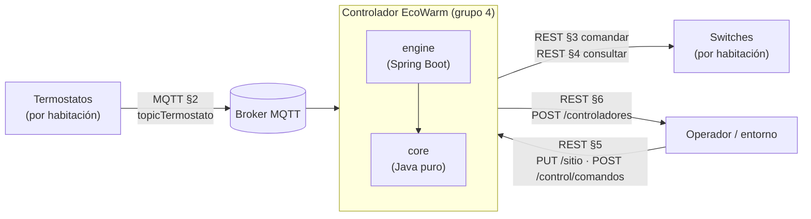
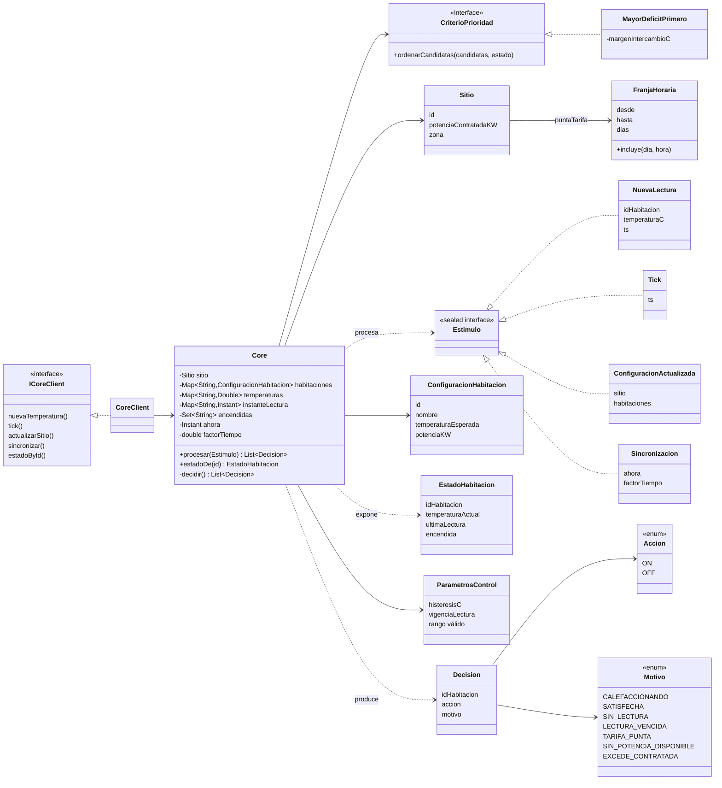
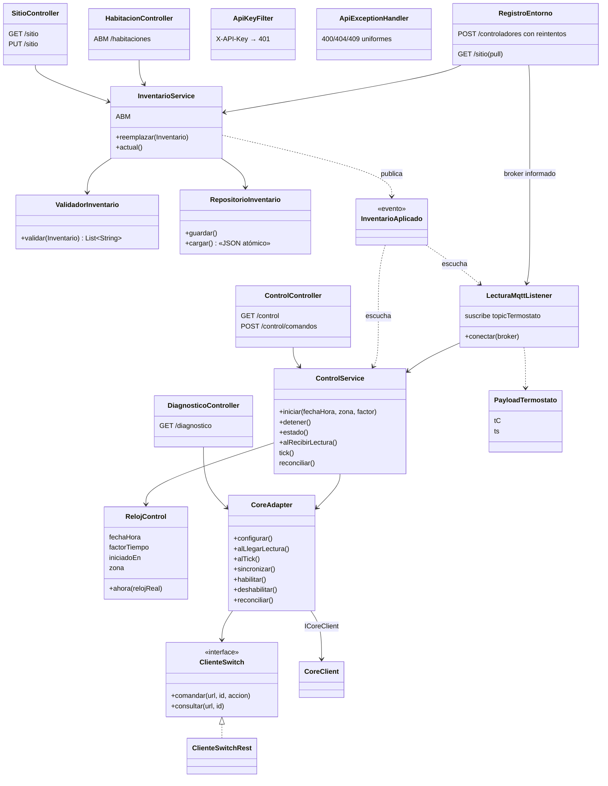
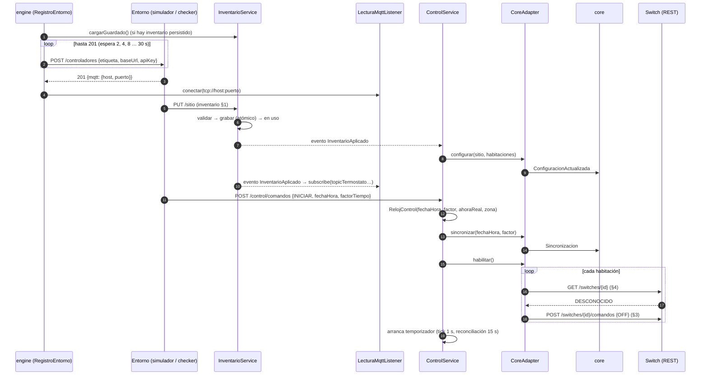
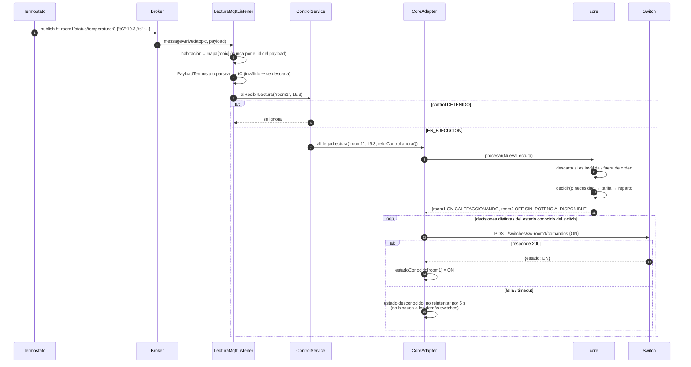
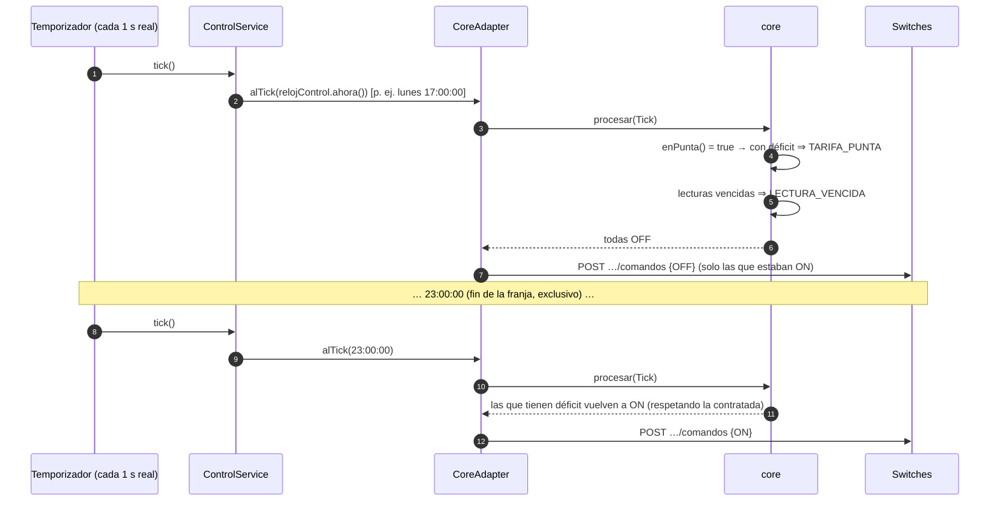
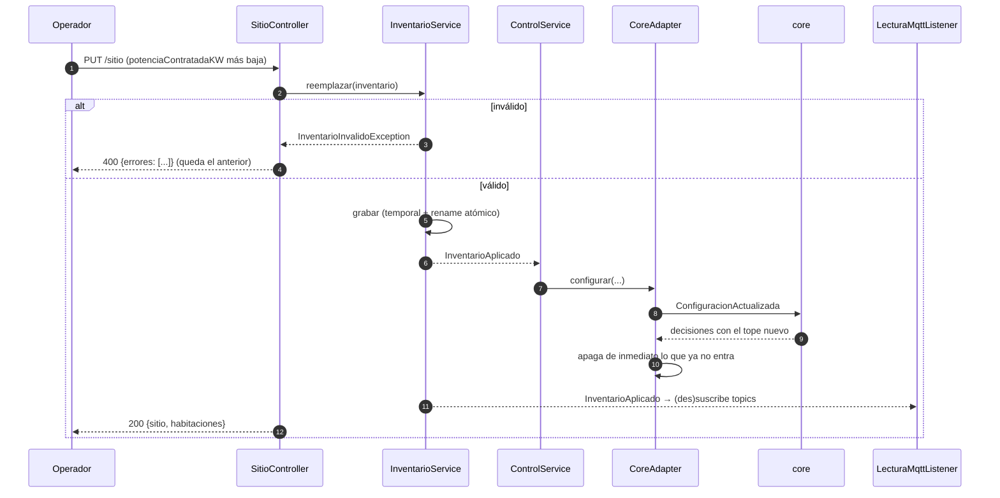

# Arquitectura del controlador EcoWarm — modelo 4+1

Se documenta en forma incremental con la técnica 4+1 de Kruchten. En la **Iteración 4** se
presentan la **vista lógica** y los **diagramas de secuencia** del manejo de eventos; las vistas
de procesos, desarrollo y física, y los escenarios completos se agregan en las iteraciones 5 y 6.

| Vista | Estado | Dónde |
|---|---|---|
| Lógica | ✅ Iteración 4 | §1 |
| Escenarios (+1) — secuencias de eventos | ✅ Iteración 4 (parcial) | §2 |
| Procesos | ⏳ Iteración 5 (adelanto en §3) | §3 |
| Desarrollo | ⏳ Iteración 5–6 (adelanto en §4) | §4 |
| Física | ⏳ Iteración 6 | — |

Los diagramas están en Mermaid (GitHub los dibuja).

---

## 1. Vista lógica

### 1.1 Contexto

El controlador está entre los termostatos (MQTT), los switches (REST) y quien lo opera (REST).
En integración, el **entorno** (simulador de la cátedra o `ecowarm-check`) juega todos esos
papeles y además ofrece el registro (§6 del estándar).



### 1.2 Módulos

| Módulo | Responsabilidad | Depende de |
|---|---|---|
| **core** | Decidir qué habitación recibe energía, con un modelo interno del estado, los estímulos y las decisiones. Sin comunicación externa, sin reloj del sistema, sin azar. | nada (solo JUnit en test) |
| **engine** | Conectar el core con el mundo: MQTT, REST entrante y saliente, persistencia, registro, reloj del control y eventos temporales. | core, Spring Boot, Paho |

La dirección de dependencia la impone Maven: `core` no tiene dependencias de producción, así que
el compilador impide que importe algo del engine.

### 1.3 Core — diagrama de clases



**La función de decisión** (`Core.decidir`) se recalcula entera ante cada estímulo, en tres pasos:

1. **Necesidad** de cada habitación, en este orden: sin lectura → `SIN_LECTURA`; lectura más vieja
   que la vigencia (escalada por el factor de tiempo) → `LECTURA_VENCIDA`; temperatura ≥ umbral →
   `SATISFECHA` (umbral = esperada si está encendida, esperada − histéresis si está apagada);
   potencia > contratada → `EXCEDE_CONTRATADA`; si no, **tiene déficit**.
2. **Tarifa**: si la hora del control cae en la franja punta, todas las que tienen déficit →
   `TARIFA_PUNTA`.
3. **Reparto**: las que tienen déficit se ordenan con el `CriterioPrioridad` y se les asigna la
   potencia contratada en ese orden (`CALEFACCIONANDO`); la que no entra → `SIN_POTENCIA_DISPONIBLE`
   y se sigue con la siguiente (una grande no bloquea a una chica que sí entra).

**Criterio de prioridad** (`MayorDeficitPrimero`): mayor déficit (esperada − actual) primero; la que
ya está encendida suma un margen de 0.5 °C (anti-oscilación: se turnan en vez de alternar en cada
lectura); desempate por id. Es no azaroso y justificable: "la que más lejos está de su objetivo es la
que más necesita la energía ahora".

### 1.4 Engine — diagrama de clases



Decisiones de diseño relevantes:

- **Un solo punto de contacto con el core** (`CoreAdapter`), que serializa las llamadas: el core no es
  thread-safe y le llegan eventos de MQTT, del temporizador y de REST.
- **Estado deseado vs estado conocido.** El adaptador recuerda la última decisión de cada habitación y
  el último estado *conocido* de su switch (por la respuesta del comando o por la consulta §4), y solo
  comanda cuando difieren. La reconciliación periódica corrige un switch que reinició
  (`DESCONOCIDO`), que alguien movió a mano o cuyo comando se perdió.
- **El reloj lo pone el engine.** Las lecturas se estampan con la hora del control al llegar (no con
  el `ts` del payload), así el core decide siempre con el reloj sincronizado (§5.2), también con
  tiempo acelerado.
- **Inventario como única fuente de verdad**, persistido en un archivo JSON con escritura atómica. El
  ABM de habitaciones opera sobre el mismo inventario.
- **Desacople por evento** (`InventarioAplicado`): el inventario no conoce a quién le interesa; el
  control y el listener MQTT lo adoptan en caliente.

---

## 2. Escenarios (+1): secuencias del manejo de eventos

### 2.1 Arranque, registro y puesta en marcha (§6, §5.1, §5.2)



### 2.2 Llega una lectura de temperatura (evento MQTT)



### 2.3 Evento temporal: entrada y salida de la franja punta



### 2.4 Cambio de configuración en caliente (`PUT /sitio` con el control en ejecución)



---

## 3. Vista de procesos (adelanto — se completa en la Iteración 5)

| Hilo | Origen | Qué hace |
|---|---|---|
| Tomcat (HTTP) | requests REST | `PUT /sitio`, `INICIAR`/`DETENER`, consultas |
| Paho callback | broker MQTT | `messageArrived` → `ControlService.alRecibirLectura` |
| `mqtt-conexion` | propio | conexión, reintentos cada 5 s y (re)suscripciones (nunca desde el hilo de Paho: deadlock) |
| `control-temporizador` | propio | tick cada 1 s real y reconciliación cada 15 s |
| `registro-entorno` | propio | registro §6 con reintentos exponenciales |

Todos convergen en `CoreAdapter` (métodos `synchronized`), que es el único que toca el core.
**Fallas previstas en el diseño** (endurecimiento y pruebas en It. 5): broker caído al arrancar o
durante la ejecución (reintento + re-suscripción), entorno que tarda en levantar (reintento del
registro), switch caído o lento (timeouts cortos, espera entre reintentos, reconciliación),
termostato muerto (vigencia de lecturas en el core), reinicio del controlador (inventario persistido).

## 4. Vista de desarrollo (adelanto)

```
modules/
├── core/      uy.edu.utec.iiss.core          Core, CriterioPrioridad, MayorDeficitPrimero
│              uy.edu.utec.iiss.core.model    Estimulo, Decision, Motivo, Sitio, ...
│              uy.edu.utec.iiss.core.cliente  ICoreClient / CoreClient (fachada)
└── engine/    uy.edu.utec.iiss.engine
               ├── inventario/  §1 y §5.1: modelo, validación, persistencia
               ├── control/     §5.2: reloj del control, INICIAR/DETENER, temporizador
               ├── adaptador/   CoreAdapter (único puente con el core)
               ├── switches/    §3/§4: cliente REST de los switches
               ├── mqtt/        §2: consumidor de los termostatos
               ├── registro/    §6: registro ante el entorno y arranque
               ├── rest/        controllers, filtro X-API-Key, errores uniformes
               └── config/      armado del core y del adaptador
```
