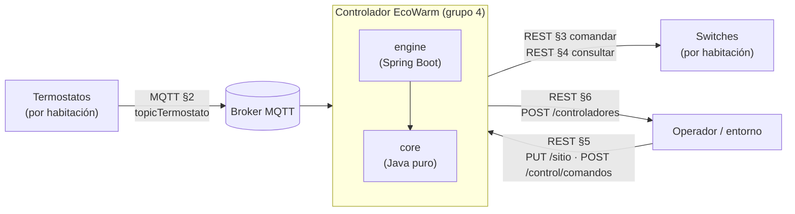
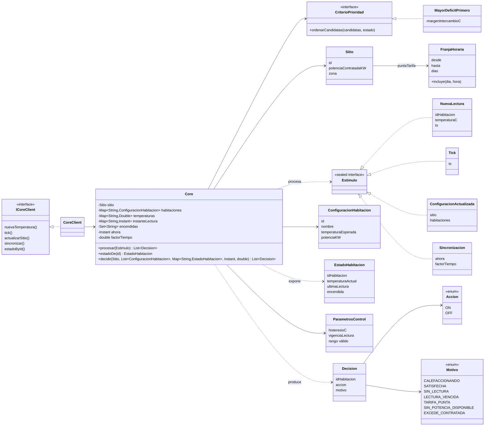
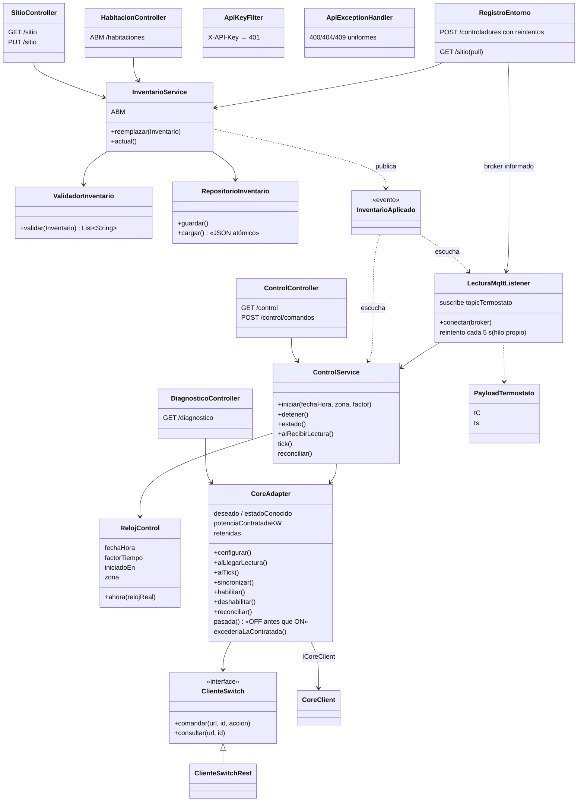
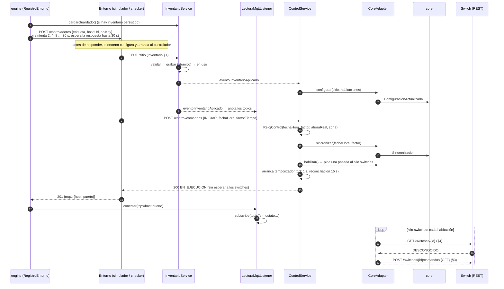
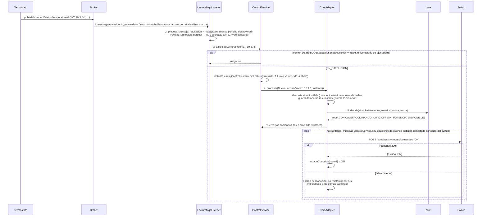
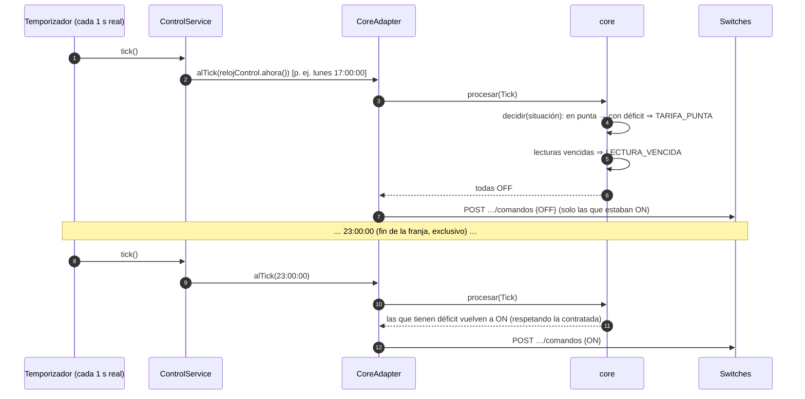
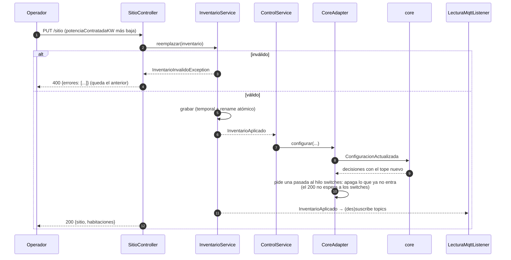
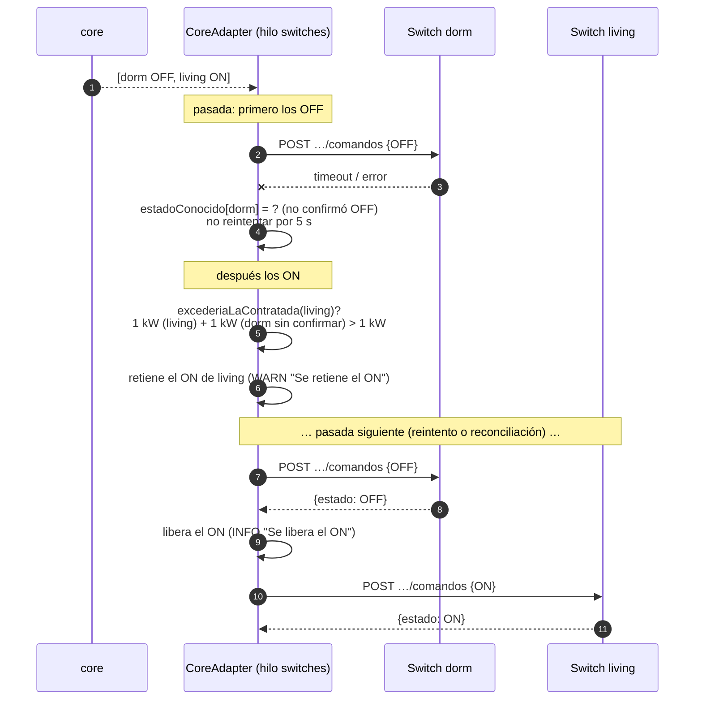
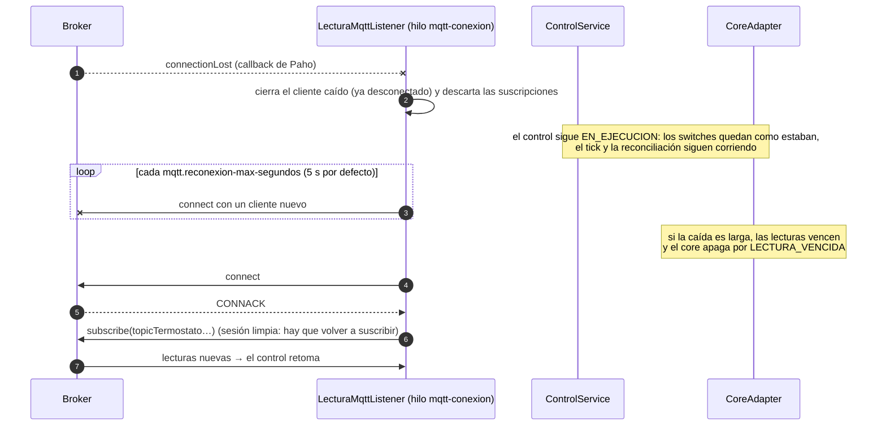

# Arquitectura del controlador EcoWarm — modelo 4+1

Se documenta en forma incremental con la técnica 4+1 de Kruchten. En la **Iteración 4** se
presentaron la **vista lógica** y los **diagramas de secuencia** del manejo de eventos. En la
**Iteración 5** se completa la **vista de procesos** con el manejo de fallas, se agregan los
escenarios de falla (§2.5 y §2.6) y se actualiza la vista de desarrollo con los tests de
integración. La vista física queda para la iteración 6.

| Vista | Estado | Dónde |
|---|---|---|
| Lógica | ✅ Iteración 4, actualizada en la 5 | §1 |
| Escenarios (+1): secuencias de eventos | ✅ Iteración 4 + fallas en la 5 | §2 |
| Procesos | ✅ Iteración 5 | §3 |
| Desarrollo | ✅ Iteración 5 (se completa en la 6) | §4 |
| Física | ⏳ Iteración 6 | — |

Los diagramas están en Mermaid (GitHub los dibuja).

---

## 1. Vista lógica

### 1.1 Contexto

El controlador está entre los termostatos (MQTT), los switches (REST) y quien lo opera (REST).
En integración, el **entorno** (simulador de la cátedra o `ecowarm-check`) juega todos esos
papeles y además ofrece el registro (§6 del estándar).



### 1.2 Módulos

| Módulo | Responsabilidad | Depende de |
|---|---|---|
| **core** | Decidir qué habitación recibe energía, con un modelo interno del estado, los estímulos y las decisiones. Sin comunicación externa, sin reloj del sistema, sin azar. | nada (solo JUnit en test) |
| **engine** | Conectar el core con el mundo: MQTT, REST entrante y saliente, persistencia, registro, reloj del control y eventos temporales. | core, Spring Boot, Paho |

La dirección de dependencia la impone Maven: `core` no tiene dependencias de producción, así que
el compilador impide que importe algo del engine.

### 1.3 Core — diagrama de clases



**Estado vs decisión.** `Core.procesar(estimulo)` actualiza el estado interno (temperaturas, instante
de cada lectura, reloj del control, configuración) y después arma la situación actual —sitio,
habitaciones, un `EstadoHabitacion` por habitación (temperatura, cuándo se midió, si está encendida),
hora del control y factor de tiempo— y se la pasa a `Core.decidir`. Con el resultado recuerda cuáles
quedaron encendidas, que es lo que necesitan la histéresis y el margen del criterio en la próxima
decisión.

**La función de decisión** (`Core.decidir`) es pública y recibe por parámetro todo lo que usa: no lee
ni modifica el estado del core, así que una misma situación da siempre las mismas decisiones. Se
recalcula entera ante cada estímulo, en tres pasos:

1. **Necesidad** de cada habitación, en este orden: sin lectura → `SIN_LECTURA`; lectura más vieja
   que la vigencia (escalada por el factor de tiempo) → `LECTURA_VENCIDA`; temperatura ≥ umbral →
   `SATISFECHA` (umbral = esperada si está encendida, esperada − histéresis si está apagada);
   potencia > contratada → `EXCEDE_CONTRATADA`; si no, **tiene déficit**.
2. **Tarifa**: si la hora del control cae en la franja punta, todas las que tienen déficit →
   `TARIFA_PUNTA`.
3. **Reparto**: las que tienen déficit se ordenan con el `CriterioPrioridad` y se les asigna la
   potencia contratada en ese orden (`CALEFACCIONANDO`); la que no entra → `SIN_POTENCIA_DISPONIBLE`
   y se sigue con la siguiente (una grande no bloquea a una chica que sí entra).

**Criterio de prioridad** (`MayorDeficitPrimero`): mayor déficit (esperada − actual) primero; la que
ya está encendida suma un margen de 0.5 °C (anti-oscilación: se turnan en vez de alternar en cada
lectura); desempate por id. Es no azaroso y justificable: "la que más lejos está de su objetivo es la
que más necesita la energía ahora".

### 1.4 Engine — diagrama de clases



Decisiones de diseño relevantes:

- **Un solo punto de contacto con el core** (`CoreAdapter`), que serializa las llamadas: el core no es
  thread-safe y le llegan eventos de MQTT, del temporizador y de REST. La comunicación con los
  switches corre aparte, en su propio hilo (ver §3), para que nadie espere a la red.
- **Estado deseado vs estado conocido.** El adaptador recuerda la última decisión de cada habitación y
  el último estado *conocido* de su switch (por la respuesta del comando o por la consulta §4), y solo
  comanda cuando difieren. La reconciliación periódica corrige un switch que reinició
  (`DESCONOCIDO`), que alguien movió a mano o cuyo comando se perdió.
- **El reloj lo pone el engine.** Las lecturas se estampan con la hora del control al llegar (no con
  el `ts` del payload), así el core decide siempre con el reloj sincronizado (§5.2), también con
  tiempo acelerado.
- **Inventario como única fuente de verdad**, persistido en un archivo JSON con escritura atómica. El
  ABM de habitaciones opera sobre el mismo inventario.
- **Desacople por evento** (`InventarioAplicado`): el inventario no conoce a quién le interesa; el
  control y el listener MQTT lo adoptan en caliente.
- **La potencia contratada se cuida también en la red** (Iteración 5). El core nunca decide más
  de la contratada, pero los comandos pueden fallar. Por eso en cada pasada el adaptador manda
  primero los OFF y después los ON, y retiene un ON si, contando como encendida toda habitación
  cuyo switch no confirmó OFF, se superaría la contratada (ver §2.5).

---

## 2. Escenarios (+1): secuencias del manejo de eventos

### 2.1 Arranque, registro e inicio del control (§6, §5.1, §5.2)



### 2.2 Llega una lectura de temperatura (evento MQTT)



Una lectura recorre **5 pasos**, cada uno con una responsabilidad: (1) `messageArrived`, callback de Paho con el único try/catch; (2) `procesarMensaje`, que resuelve la habitación por el topic y parsea el payload (se prueba sin broker); (3) `ControlService.alRecibirLectura`, dueño del reloj del control; (4) `CoreAdapter.procesar`, dueño del estado y del estado de ejecución (T7b); (5) `Core.decidir`, la función pura. Antes eran 10: `CoreClient` y el `procesar` del core, que guardaba un estado duplicado, se eliminaron (tarjetas T4, T5 y T7).

**Instante de la lectura (`ts`, tarjeta T8).** La lectura se guarda con el instante que informa el termostato (`ts`, epoch con 3 decimales, §2), leído exacto con `BigDecimal`. Ese instante es el que se compara para descartar las lecturas que llegan fuera de orden (`ts` anterior a la última guardada) y el que se usa para el vencimiento. Si falta, está en el futuro o es tan viejo que llegaría ya vencido, no puede ser una medición recién hecha (reloj desfasado o en otra escala) y se usa la hora del control al recibirla; la temperatura nunca se descarta por eso. **Pendiente de confirmar con el docente:** el estándar no dice si, con tiempo acelerado, el simulador escribe el `ts` en tiempo simulado o real. Por defecto se toma como hora del control (`termostato.ts-tiempo-real=false`); si es real, con `true` se convierte con el `RelojControl` (`fechaHora + (ts − iniciadoEn) × factor`). Con cualquiera de las dos suposiciones, si resulta equivocada, el peor caso es el comportamiento sin `ts`.

### 2.3 Evento temporal: entrada y salida de la franja punta



### 2.4 Cambio de configuración en caliente (`PUT /sitio` con el control en ejecución)



### 2.5 Falla el OFF que liberaba potencia (Iteración 5)

Dos habitaciones de 1 kW con 1 kW contratado: el core pasa la energía de `dorm` a `living`.



Lo verifica `FallaSwitchTest`.

### 2.6 El broker MQTT cae y vuelve (Iteración 5)



Lo verifican `FallaBrokerMqttTest` y `TermostatoCaidoTest`.

No se usa la reconexión automática de Paho. Su espera entre reintentos es un campo estático,
compartido por todos los clientes de la JVM, que se duplica en cada intento fallido. Además, un
cliente que se cierra en medio de un reintento queda vivo y sigue reconectándose. Reconectar desde
el hilo propio deja la espera fija y garantiza que al apagar no quede ningún cliente.

---

## 3. Vista de procesos (Iteración 5)

| Hilo | Origen | Qué hace |
|---|---|---|
| Tomcat (HTTP) | requests REST | `PUT /sitio`, `INICIAR`/`DETENER`, consultas |
| Paho callback | broker MQTT | `messageArrived` → `ControlService.alRecibirLectura` |
| `mqtt-conexion` | propio | conexión y reconexión tras una caída (reintento cada 5 s, cliente nuevo) y (re)suscripciones (nunca desde el hilo de Paho: deadlock) |
| `control-temporizador` | propio | tick cada 1 s real y reconciliación cada 15 s |
| `registro-entorno` | propio | registro §6 con reintentos exponenciales |
| `switches` | propio (`CoreAdapter`) | todo el I/O con los switches: consultas §4 y comandos §3, en pasadas |

Todos convergen en `CoreAdapter` (métodos `synchronized`), que es el único que toca el core. El core
se llama dentro del bloqueo, pero **la red hacia los switches no**: cada estímulo actualiza lo
deseado, pide una pasada al hilo `switches` y vuelve. Así `INICIAR` y `PUT /sitio` responden sin
esperar a los switches —importante porque en el registro §6 el entorno nos da `INICIAR` antes de
responder, y es él mismo quien sirve los switches: esperar ahí era un bloqueo circular— y un switch
lento no demora al core, a MQTT ni al API. Los pedidos que llegan durante una pasada se juntan en una
sola pasada siguiente, que usa la decisión vigente en ese momento. Las pasadas son secuenciales: un
switch lento todavía demora a los demás switches hasta su timeout (la espera entre reintentos lo
acota).

### 3.1 Manejo de fallas

| Falla | Qué hace el controlador | Hilo | Test |
|---|---|---|---|
| Broker caído al arrancar | reintenta cada 5 s; al conectar se suscribe a los topics del inventario | `mqtt-conexion` | `ApiEstandarTest`, `FallaBrokerMqttTest` |
| Broker cae durante la ejecución | se descarta el cliente caído y se reintenta cada 5 s con uno nuevo; al volver se re-suscribe. El control sigue y no toca los switches por la caída | `mqtt-conexion` | `FallaBrokerMqttTest` |
| Se pierden mensajes o llegan corruptos | un payload inválido se descarta; la decisión usa la última lectura válida mientras esté vigente | Paho callback | `PerdidaMensajesTest` |
| Termostato deja de publicar | la lectura vence (10 min reales, escalados por `factorTiempo`) y el core apaga por `LECTURA_VENCIDA` | `control-temporizador` | `TermostatoCaidoTest` |
| Switch no responde o da error | timeout corto; no se le reintenta por 5 s; los demás switches se siguen comandando; la reconciliación lo corrige al volver | `switches` | `FallaSwitchTest`, `CoreAdapterTest` |
| Falla el OFF que liberaba potencia | se retiene el ON que superaría la contratada hasta que el OFF se confirme (§2.5) | `switches` | `FallaSwitchTest` |
| Switch reiniciado o movido a mano | la consulta §4 lo ve distinto de lo deseado y lo vuelve a comandar | `switches` | `CoreAdapterTest` |
| Entorno que tarda en levantar | el registro reintenta con espera exponencial (2, 4, 8 … 30 s) | `registro-entorno` | — |
| Reinicio del controlador | el inventario se recupera del archivo JSON; uno corrupto no impide arrancar | `main` | `RepositorioInventarioTest` |

## 4. Vista de desarrollo

```
modules/
├── core/      uy.edu.utec.iiss.core          Core, CriterioPrioridad, MayorDeficitPrimero
│              uy.edu.utec.iiss.core.model    Estimulo, Decision, Motivo, Sitio, ...
│              uy.edu.utec.iiss.core.cliente  ICoreClient / CoreClient (fachada)
│              src/test                       DecidirTest (por situación), CoreTest (por estímulos),
│                                             MayorDeficitPrimeroTest, CoreClientTest, ModeloTest
└── engine/    uy.edu.utec.iiss.engine
               ├── inventario/  §1 y §5.1: modelo, validación, persistencia
               ├── control/     §5.2: reloj del control, INICIAR/DETENER, temporizador
               ├── adaptador/   CoreAdapter (único puente con el core)
               ├── switches/    §3/§4: cliente REST de los switches
               ├── mqtt/        §2: consumidor de los termostatos
               ├── registro/    §6: registro ante el entorno y arranque
               ├── rest/        controllers, filtro X-API-Key, errores uniformes
               ├── config/      armado del core y del adaptador
               └── src/test/…/integracion/
                                IntegracionBase (contexto Spring + BrokerMqttEmbebido (Moquette)
                                + SwitchesHttpFalsos), ControlCargaTest, ArranqueParadaTest,
                                CambioConfiguracionTest, FallaBrokerMqttTest, PerdidaMensajesTest,
                                FallaSwitchTest, TermostatoCaidoTest
```

Formato del código: Spotless con google-java-format (AOSP), configurado en el `pom.xml` padre;
`mvn verify` falla si algo no cumple (ver [`docs/calidad/`](../calidad/README.md)).
