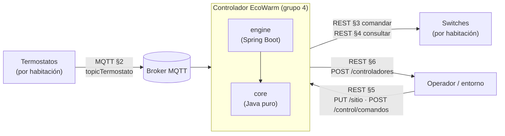
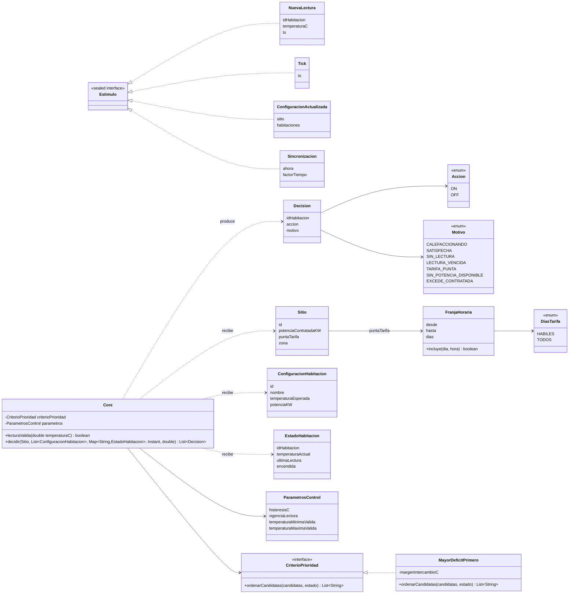
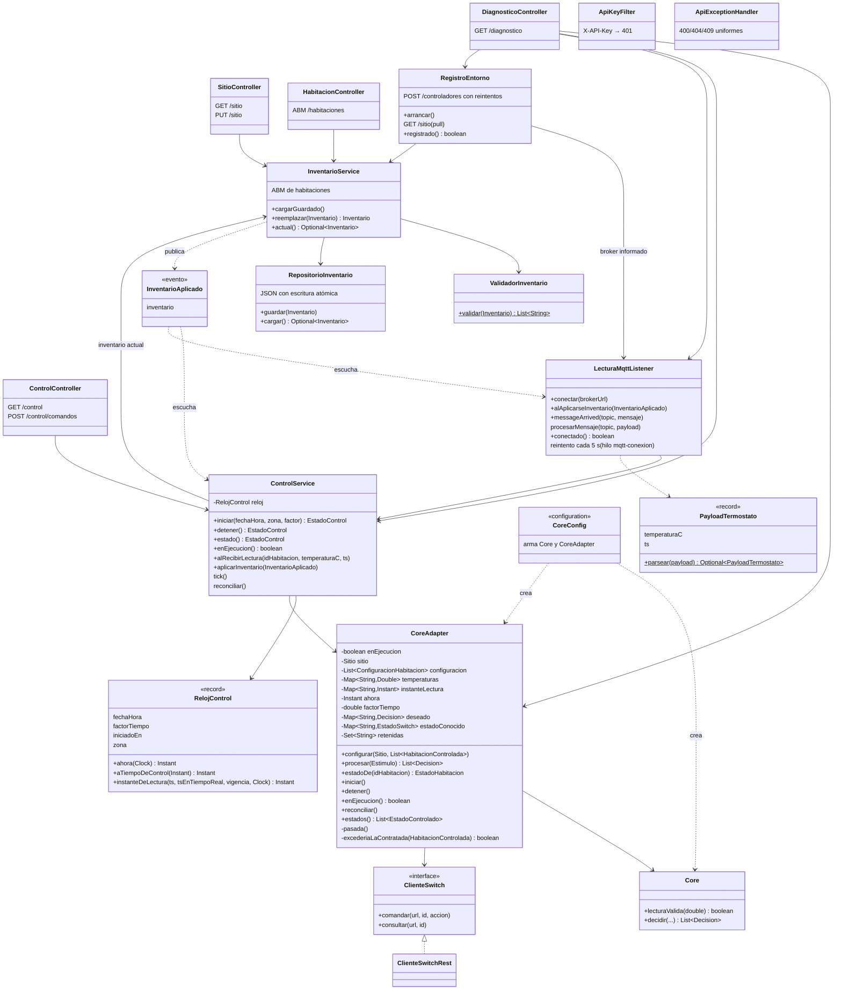
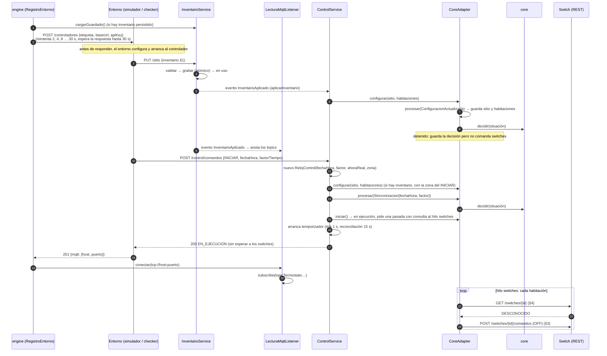
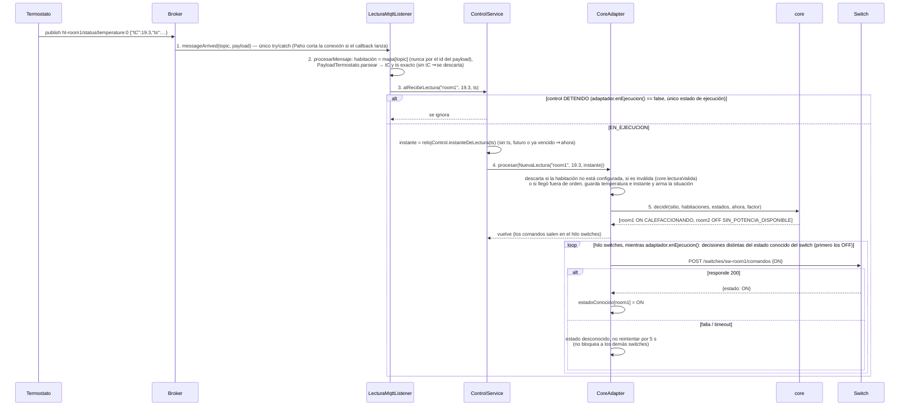
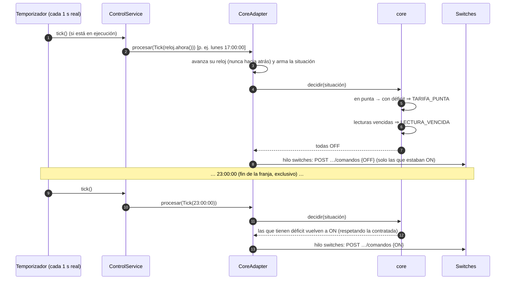
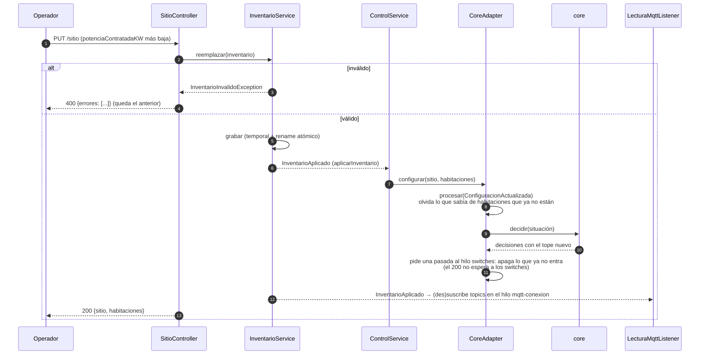
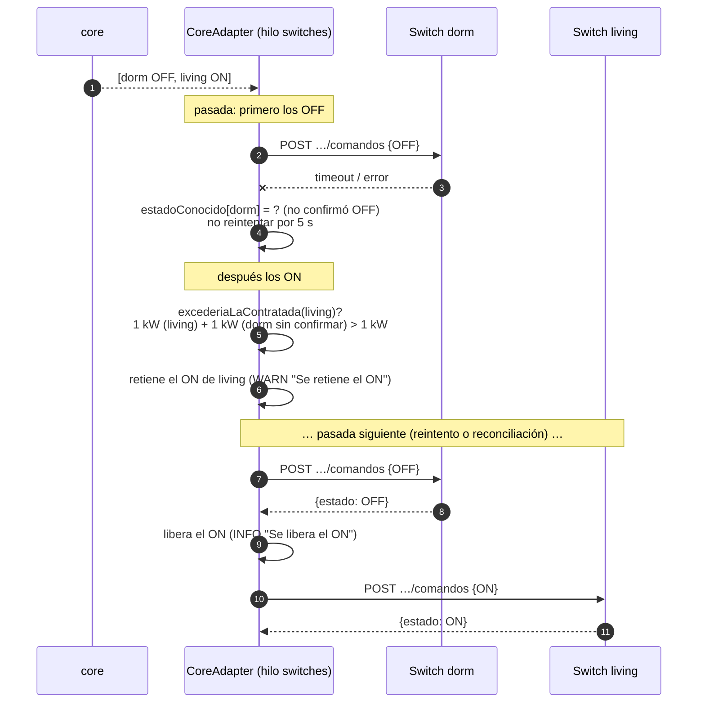
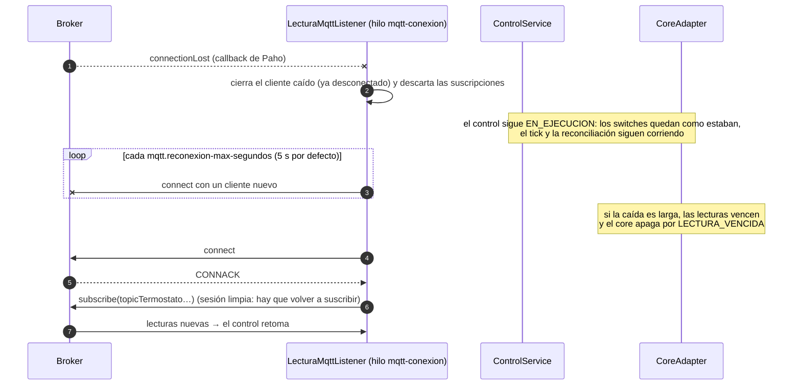

# Arquitectura del controlador EcoWarm — modelo 4+1

Se documenta en forma incremental con la técnica 4+1 de Kruchten. En la **Iteración 4** se
presentaron la **vista lógica** y los **diagramas de secuencia** del manejo de eventos. En la
**Iteración 5** se completa la **vista de procesos** con el manejo de fallas, se agregan los
escenarios de falla (§2.5 y §2.6) y se actualiza la vista de desarrollo con los tests de
integración. La vista física queda para la iteración 6.

Tras la revisión docente de la iteración 5 (tarjetas T4, T5, T7 y T7b) las vistas describen el diseño
actual: el core contiene el modelo y la función pura `decidir`, y el estado del control (situación y
estado de ejecución) lo guarda `CoreAdapter` en el engine.

| Vista | Estado | Dónde |
|---|---|---|
| Lógica | ✅ Iteración 4, actualizada en la 5 (diseño actual, T11a) | §1 |
| Escenarios (+1): secuencias de eventos | ✅ Iteración 4 + fallas en la 5 (diseño actual, T11a) | §2 |
| Procesos | ✅ Iteración 5 (diseño actual, T11a) | §3 |
| Desarrollo | ✅ Iteración 5 (diseño actual, T11a; se completa en la 6) | §4 |
| Física | ⏳ Iteración 6 (tarjeta T11) | — |

Los diagramas están en Mermaid (GitHub los dibuja).

---

## 1. Vista lógica

### 1.1 Contexto

El controlador está entre los termostatos (MQTT), los switches (REST) y quien lo opera (REST).
En integración, el **entorno** (simulador de la cátedra o `ecowarm-check`) juega todos esos
papeles y además ofrece el registro (§6 del estándar).



### 1.2 Módulos

| Módulo | Responsabilidad | Depende de |
|---|---|---|
| **core** | Decidir qué habitación recibe energía, con un modelo interno del estado, los estímulos y las decisiones. El modelo son los records y enums de `core.model` (`EstadoHabitacion`, `Estimulo`, `Decision`, `Sitio`, `ConfiguracionHabitacion`, `ParametrosControl`, `FranjaHoraria`, `Accion`, `Motivo`, `DiasTarifa`); la decisión es la función pura `Core.decidir`. El core **no guarda estado** entre llamadas: recibe la situación por parámetro. Sin comunicación externa, sin reloj del sistema, sin azar. | nada (solo JUnit en test) |
| **engine** | Conectar el core con el mundo: MQTT, REST entrante y saliente, persistencia, registro, reloj del control y eventos temporales. Guarda el estado del control en `CoreAdapter` (temperaturas, instantes de lectura, sitio, reloj, última decisión, estado de ejecución) y se lo pasa a `Core.decidir`. | core, Spring Boot, Paho |

La dirección de dependencia la impone Maven: `core` no tiene dependencias de producción, así que
el compilador impide que importe algo del engine.

### 1.3 Core — diagrama de clases



`Core` solo tiene campos finales (el criterio y los parámetros), así que no tiene estado y se puede
compartir entre hilos. Los `Estimulo` son parte del modelo del core (`core.model`), pero no los
procesa el core: los procesa `CoreAdapter.procesar` en el engine (§1.4), con un `switch` exhaustivo
sobre la interfaz `sealed`.

**Estado vs decisión.** El estado del control vive en el engine, en `CoreAdapter`: sitio y
configuración de las habitaciones, la última temperatura válida y el instante de cada lectura, el
reloj del control (`ahora`), el factor de tiempo y la última decisión de cada habitación (que dice
cuáles están encendidas, lo que necesitan la histéresis y el margen del criterio). Ante cada estímulo,
`CoreAdapter.procesar` actualiza ese estado, arma la situación actual —sitio, habitaciones, un
`EstadoHabitacion` por habitación (temperatura, cuándo se midió, si está encendida), hora del control
y factor de tiempo— y se la pasa por parámetro a `Core.decidir`. El core no guarda nada entre
llamadas: es una función pura, y la misma situación da siempre las mismas decisiones. Antes de guardar
una lectura, el adaptador le pregunta al core si la temperatura es válida (`Core.lecturaValida`:
finita y dentro del rango físico del sensor, de −40 °C a 85 °C).

**La función de decisión** (`Core.decidir`) es pública y recibe por parámetro todo lo que usa, salvo
el criterio y los parámetros de control, que fija el constructor. Se recalcula entera ante cada
estímulo, en tres pasos (con `ahora` en null, todavía sin hora del control, no hay punta ni
vencimientos):

1. **Necesidad** de cada habitación, en este orden: sin lectura → `SIN_LECTURA`; lectura más vieja
   que la vigencia (en tiempo de control, sin escalar por el factor: T8c) → `LECTURA_VENCIDA`; temperatura ≥ umbral →
   `SATISFECHA` (umbral = esperada si está encendida, esperada − histéresis si está apagada);
   potencia > contratada → `EXCEDE_CONTRATADA`; si no, **tiene déficit**.
2. **Tarifa**: si la hora del control cae en la franja punta, todas las que tienen déficit →
   `TARIFA_PUNTA`.
3. **Reparto**: las que tienen déficit se ordenan con el `CriterioPrioridad` y se les asigna la
   potencia contratada en ese orden (`CALEFACCIONANDO`); la que no entra → `SIN_POTENCIA_DISPONIBLE`
   y se sigue con la siguiente (una grande no bloquea a una chica que sí entra).

**Criterio de prioridad** (`MayorDeficitPrimero`): mayor déficit (esperada − actual) primero; la que
ya está encendida suma un margen de 0.5 °C (anti-oscilación: se turnan en vez de alternar en cada
lectura); desempate por id. Es no azaroso y justificable: "la que más lejos está de su objetivo es la
que más necesita la energía ahora".

### 1.4 Engine — diagrama de clases



Las dependencias del control van en un solo sentido: `ControlService` → `CoreAdapter` → `Core`. El
adaptador nunca llama a `ControlService` y el core no conoce a nadie del engine.

Decisiones de diseño relevantes:

- **Un solo punto de contacto con el core** (`CoreAdapter`), que además es el único dueño del estado
  del control. El core no tiene estado, pero el adaptador sí, y le llegan estímulos de MQTT, del
  temporizador y de REST: por eso sus métodos son `synchronized` y procesan un estímulo por vez. La
  comunicación con los switches corre aparte, en su propio hilo (ver §3), para que nadie espere a la
  red.
- **Un solo estado de ejecución** (tarjetas T7 y T7b). Si el control está en ejecución lo dice
  `CoreAdapter.enEjecucion()`, que cambia con `iniciar()` y `detener()`. `ControlService` le delega
  (`ControlService.enEjecucion()` devuelve `adaptador.enEjecucion()`) y no guarda una copia: su campo
  `reloj` solo da la hora (y queda con el último INICIAR después de DETENER). Detenido, el adaptador
  sigue decidiendo (por ejemplo, ante un `PUT /sitio`) pero no comanda ningún switch.
- **Estado deseado vs estado conocido.** El adaptador recuerda la última decisión de cada habitación y
  el último estado *conocido* de su switch (por la respuesta del comando o por la consulta §4), y solo
  comanda cuando difieren. La reconciliación periódica corrige un switch que reinició
  (`DESCONOCIDO`), que alguien movió a mano o cuyo comando se perdió.
- **El reloj lo pone el engine.** `ControlService` mantiene el `RelojControl` (§5.2) y estampa cada
  estímulo con la hora del control: el Tick con `ahora`, y la lectura con el instante que da
  `RelojControl.instanteDeLectura` a partir del `ts` del payload (§2.2). El core nunca lee el reloj del
  sistema: decide con la hora que recibe por parámetro, también con tiempo acelerado.
- **Inventario como única fuente de verdad**, persistido en un archivo JSON con escritura atómica. El
  ABM de habitaciones opera sobre el mismo inventario.
- **Desacople por evento** (`InventarioAplicado`): el inventario no conoce a quién le interesa; el
  control y el listener MQTT lo adoptan en caliente.
- **La potencia contratada se cuida también en la red** (Iteración 5). El core nunca decide más
  de la contratada, pero los comandos pueden fallar. Por eso en cada pasada el adaptador manda
  primero los OFF y después los ON, y retiene un ON si, contando como encendida toda habitación
  cuyo switch no confirmó OFF, se superaría la contratada (ver §2.5).

---

## 2. Escenarios (+1): secuencias del manejo de eventos

### 2.1 Arranque, registro e inicio del control (§6, §5.1, §5.2)



### 2.2 Llega una lectura de temperatura (evento MQTT)



Una lectura recorre **5 pasos**, cada uno con una responsabilidad: (1) `messageArrived`, callback de Paho con el único try/catch; (2) `procesarMensaje`, que resuelve la habitación por el topic y parsea el payload (se prueba sin broker); (3) `ControlService.alRecibirLectura`, dueño del reloj del control; (4) `CoreAdapter.procesar`, dueño del estado y del estado de ejecución (T7b); (5) `Core.decidir`, la función pura. Antes eran 10: `CoreClient` y el `procesar` del core, que guardaba un estado duplicado, se eliminaron (tarjetas T4, T5 y T7).

**Instante de la lectura (`ts`, tarjeta T8).** La lectura se guarda con el instante que informa el termostato (`ts`, epoch con 3 decimales, §2), leído exacto con `BigDecimal`. Ese instante es el que se compara para descartar las lecturas que llegan fuera de orden (`ts` anterior a la última guardada) y el que se usa para el vencimiento. Si falta, está en el futuro o es tan viejo que llegaría ya vencido, no puede ser una medición recién hecha (reloj desfasado) y se usa la hora del control al recibirla; la temperatura nunca se descarta por eso. El simulador envía el `ts` en **hora real** (epoch del reloj real de su máquina) y el controlador debe llevarlo a la hora del control con la misma fórmula del §5.2: `tsControl = fechaHora + (ts − iniciadoEn) × factorTiempo`, donde `iniciadoEn` es la hora real en que llegó el INICIAR. La multiplicación es sobre el tiempo transcurrido, no sobre la hora entera. Ejemplo: INICIAR a las 13:00 reales con `fechaHora = 13:00` y factor 2; una lectura con `ts = 13:05` reales son 5 min × 2 = 10 min, así que su hora del control es 13:10 (con `fechaHora = 08:00` daría 08:10). Lo que todavía no refleja esa regla queda pendiente:

- La conversión está en `RelojControl.aTiempoDeControl` y la propiedad `termostato.ts-tiempo-real` vale `true` por defecto, así que el `ts` se convierte. La tarjeta T8b elimina la propiedad y deja la conversión fija.
- La conversión supone que el reloj real del simulador y el del controlador coinciden (en Docker sobre el mismo host comparten el reloj). Un desfase entre máquinas se multiplica por el factor: 2 s de desfase con factor 30 son 1 min simulado. Se verifica en la tarjeta T13.
- Un `ts` más viejo que la vigencia hoy se registra con la hora del control al recibirlo. La regla nueva (descartarla y contarla en `/diagnostico`) depende de la decisión D8 del equipo y se implementa en T8b.
- La vigencia de las lecturas se mide en tiempo de control, sin escalar por el factor (T8c), tanto en `RelojControl.instanteDeLectura` como en `Core.decidir`.

### 2.3 Evento temporal: entrada y salida de la franja punta



### 2.4 Cambio de configuración en caliente (`PUT /sitio` con el control en ejecución)



### 2.5 Falla el OFF que liberaba potencia (Iteración 5)

Dos habitaciones de 1 kW con 1 kW contratado: el core pasa la energía de `dorm` a `living`.



Lo verifica `FallaSwitchTest`.

### 2.6 El broker MQTT cae y vuelve (Iteración 5)



Lo verifican `FallaBrokerMqttTest` y `TermostatoCaidoTest`.

No se usa la reconexión automática de Paho. Su espera entre reintentos es un campo estático,
compartido por todos los clientes de la JVM, que se duplica en cada intento fallido. Además, un
cliente que se cierra en medio de un reintento queda vivo y sigue reconectándose. Reconectar desde
el hilo propio deja la espera fija y garantiza que al apagar no quede ningún cliente.

---

## 3. Vista de procesos (Iteración 5)

| Hilo | Origen | Qué hace |
|---|---|---|
| Tomcat (HTTP) | requests REST | `PUT /sitio`, `INICIAR`/`DETENER`, consultas |
| Paho callback | broker MQTT | `messageArrived` → `procesarMensaje` → `ControlService.alRecibirLectura` |
| `mqtt-conexion` | propio (`LecturaMqttListener`) | conexión y reconexión tras una caída (reintento cada 5 s, cliente nuevo) y (re)suscripciones (nunca desde el hilo de Paho: deadlock) |
| `control-temporizador` | propio (`ControlService`) | tick cada `control.tick-ms` (1 s real por defecto) y reconciliación cada 15 s; existe solo mientras el control está en ejecución |
| `registro-entorno` | propio (`RegistroEntorno`) | registro §6 con reintentos exponenciales |
| `switches` | propio (`CoreAdapter`) | todo el I/O con los switches: consultas §4 y comandos §3, en pasadas |
| `main` | Spring | al quedar lista la aplicación, `RegistroEntorno.arrancar` recupera el inventario guardado y lanza `registro-entorno` |

**Candados.** Los estímulos convergen en `CoreAdapter`, el único que toca el core y el único dueño del
estado del control, incluido el estado de ejecución. Sus métodos públicos son `synchronized`; el core
no tiene estado y se llama dentro de ese bloqueo. `ControlService` tiene su propio candado (`iniciar`,
`detener`, `alRecibirLectura`, `aplicarInventario` y `tick` son `synchronized`), para que una lectura
estampada con el reloj viejo no se procese después de que INICIAR re-sincronizó el reloj. Los
candados se toman siempre en el mismo orden (`InventarioService` → `ControlService` → `CoreAdapter`,
ya que el evento `InventarioAplicado` se publica en forma sincrónica) y nunca al revés, porque el
adaptador no llama a `ControlService`: no hay deadlock. `LecturaMqttListener` usa un candado propio
solo para la conexión y las suscripciones; el callback de Paho no lo toma.

El core se llama dentro del bloqueo, pero **la red hacia los switches no**: cada estímulo actualiza lo
deseado, pide una pasada al hilo `switches` y vuelve. La pasada toma el candado del adaptador solo para
leer o actualizar el estado, y antes de cada comando vuelve a mirar el estado de ejecución: un DETENER
que llega durante una pasada corta los comandos que faltan. Así `INICIAR` y `PUT /sitio` responden sin
esperar a los switches —importante porque en el registro §6 el entorno nos da `INICIAR` antes de
responder, y es él mismo quien sirve los switches: esperar ahí era un bloqueo circular— y un switch
lento no demora al core, a MQTT ni al API. Los pedidos que llegan durante una pasada se juntan en una
sola pasada siguiente, que usa la decisión vigente en ese momento. Las pasadas son secuenciales: un
switch lento todavía demora a los demás switches hasta su timeout (la espera entre reintentos lo
acota).

### 3.1 Manejo de fallas

| Falla | Qué hace el controlador | Hilo | Test |
|---|---|---|---|
| Broker caído al arrancar | reintenta cada 5 s; al conectar se suscribe a los topics del inventario | `mqtt-conexion` | `ApiEstandarTest`, `FallaBrokerMqttTest` |
| Broker cae durante la ejecución | se descarta el cliente caído y se reintenta cada 5 s con uno nuevo; al volver se re-suscribe. El control sigue y no toca los switches por la caída | `mqtt-conexion` | `FallaBrokerMqttTest` |
| Se pierden mensajes o llegan corruptos | un payload inválido se descarta; una temperatura fuera de rango o una lectura fuera de orden también; la decisión usa la última lectura válida mientras esté vigente | Paho callback | `PerdidaMensajesTest`, `PayloadTermostatoTest`, `CoreAdapterEstimulosTest` |
| Termostato deja de publicar | la lectura vence (10 min de tiempo de control, sin escalar por el factor: T8c) y el core apaga por `LECTURA_VENCIDA` | `control-temporizador` | `TermostatoCaidoTest` |
| Switch no responde o da error | timeout corto; no se le reintenta por 5 s; los demás switches se siguen comandando; la reconciliación lo corrige al volver | `switches` | `FallaSwitchTest`, `CoreAdapterTest` |
| Falla el OFF que liberaba potencia | se retiene el ON que superaría la contratada hasta que el OFF se confirme (§2.5) | `switches` | `FallaSwitchTest` |
| Switch reiniciado o movido a mano | la consulta §4 lo ve distinto de lo deseado y lo vuelve a comandar | `switches` | `CoreAdapterTest` |
| Entorno que tarda en levantar | el registro reintenta con espera exponencial (2, 4, 8 … 30 s) | `registro-entorno` | — |
| Reinicio del controlador | el inventario se recupera del archivo JSON; uno corrupto no impide arrancar | `main` | `RepositorioInventarioTest` |

## 4. Vista de desarrollo

```
modules/
├── core/      uy.edu.utec.iiss.core          Core (decidir, lecturaValida), CriterioPrioridad,
│                                             MayorDeficitPrimero
│              uy.edu.utec.iiss.core.model    Accion, ConfiguracionHabitacion, Decision, DiasTarifa,
│                                             EstadoHabitacion, Estimulo, FranjaHoraria, Motivo,
│                                             ParametrosControl, Sitio
│              src/test                       DecidirTest (por situación), MayorDeficitPrimeroTest,
│                                             ModeloTest, CoreTestFixtures (utilitarios)
└── engine/    uy.edu.utec.iiss.engine        EngineApplication
               ├── inventario/  §1 y §5.1: modelo, validación, persistencia, evento InventarioAplicado
               ├── control/     §5.2: ControlService (INICIAR/DETENER, temporizador),
               │                RelojControl, EstadoControl
               ├── adaptador/   CoreAdapter (único puente con el core y dueño del estado del control)
               ├── switches/    §3/§4: ClienteSwitch, ClienteSwitchRest, EstadoSwitch
               ├── mqtt/        §2: LecturaMqttListener, PayloadTermostato
               ├── registro/    §6: RegistroEntorno (registro ante el entorno y arranque)
               ├── rest/        controller/ (Sitio, Habitacion, Control, Diagnostico),
               │                security/ (ApiKeyFilter, X-API-Key), error/ (errores uniformes)
               ├── config/      CoreConfig: armado del core y del adaptador
               ├── util/        Instantes (formato ISO-8601 con milisegundos)
               └── src/test/…/
                   ├── adaptador/   CoreAdapterTest (switches, pasadas, estado de ejecución),
                   │                CoreAdapterEstimulosTest (por estímulos), EstimulosFixtures
                   ├── control/     RelojControlTest
                   ├── inventario/  ValidadorInventarioTest, RepositorioInventarioTest,
                   │                InventarioEjemplo
                   ├── mqtt/        PayloadTermostatoTest
                   ├── registro/    RegistroEntornoTest
                   ├── rest/        ApiEstandarTest
                   └── integracion/
                                IntegracionBase (contexto Spring + BrokerMqttEmbebido (Moquette)
                                + SwitchesHttpFalsos), ControlCargaTest, ArranqueParadaTest,
                                CambioConfiguracionTest, FallaBrokerMqttTest, PerdidaMensajesTest,
                                FallaSwitchTest, TermostatoCaidoTest
```

Los tests de estímulos (lectura, tick, configuración, INICIAR) eran `CoreTest` hasta la iteración 5;
con el core sin estado pasaron a `CoreAdapterEstimulosTest`, junto con `CoreAdapter.procesar`
(tarjeta T5).

Formato del código: Spotless con google-java-format (AOSP), configurado en el `pom.xml` padre;
`mvn verify` falla si algo no cumple (ver [`docs/calidad/`](../calidad/README.md)).
