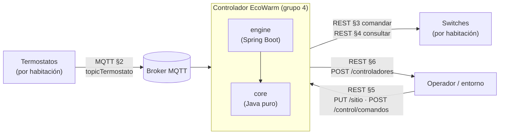
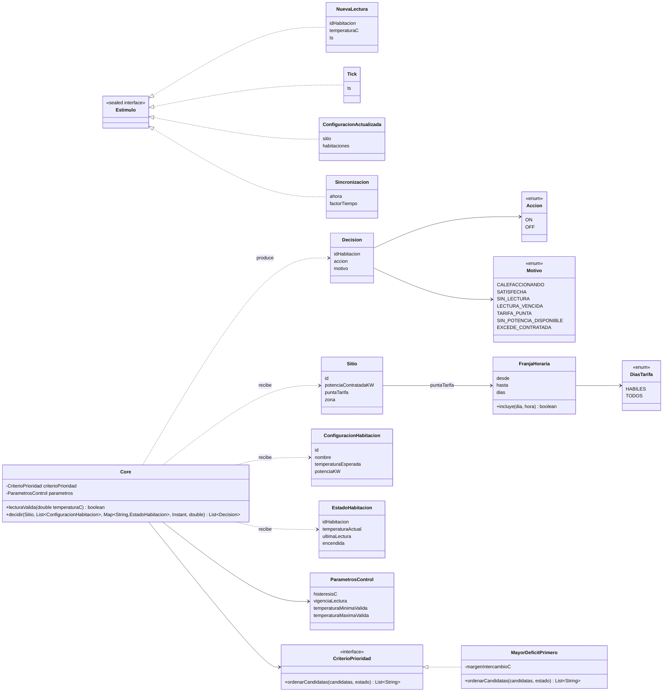
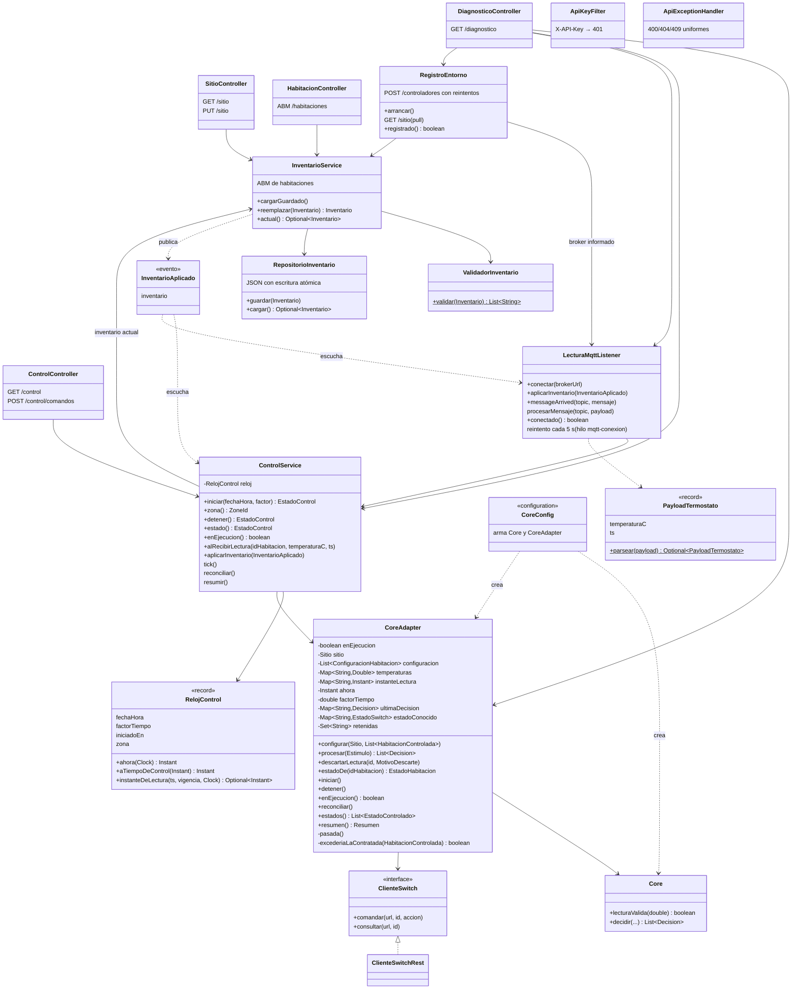
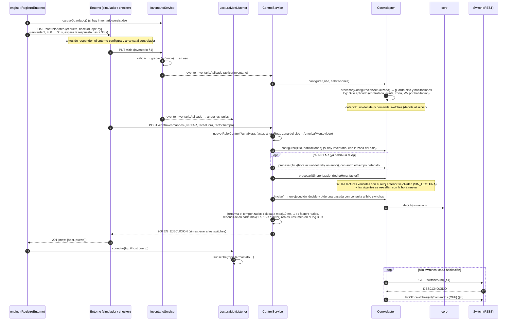
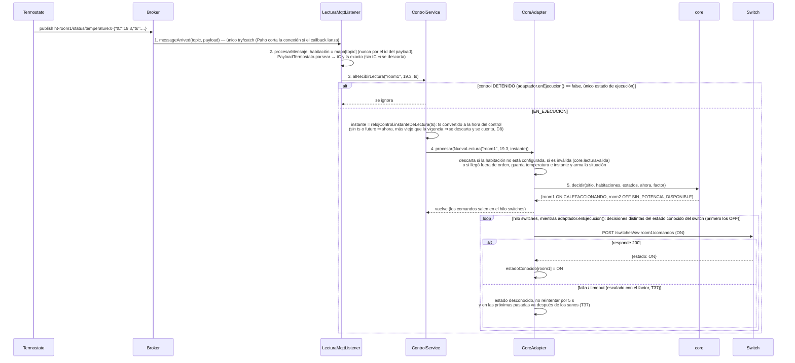
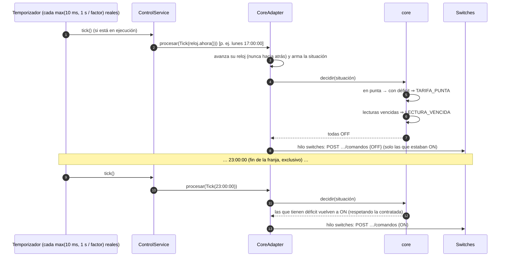
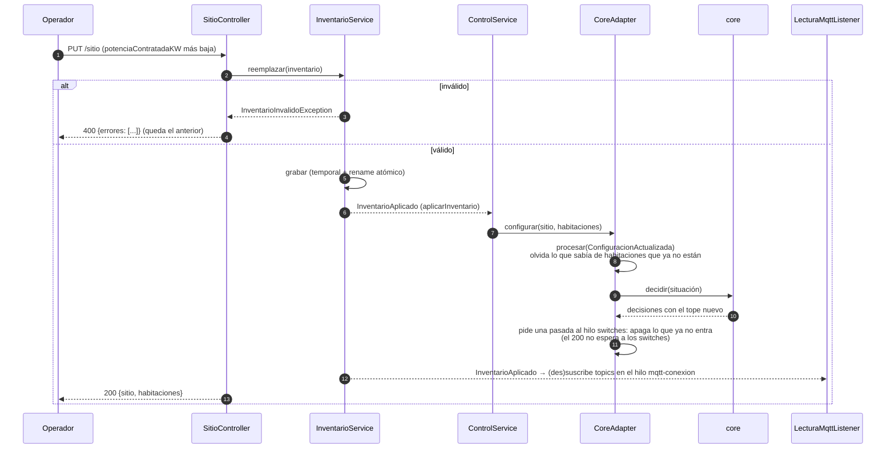
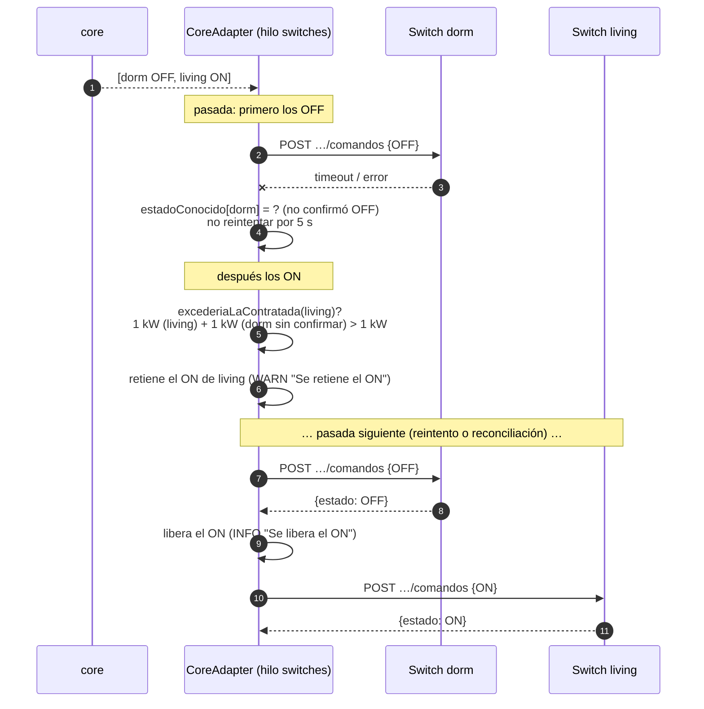
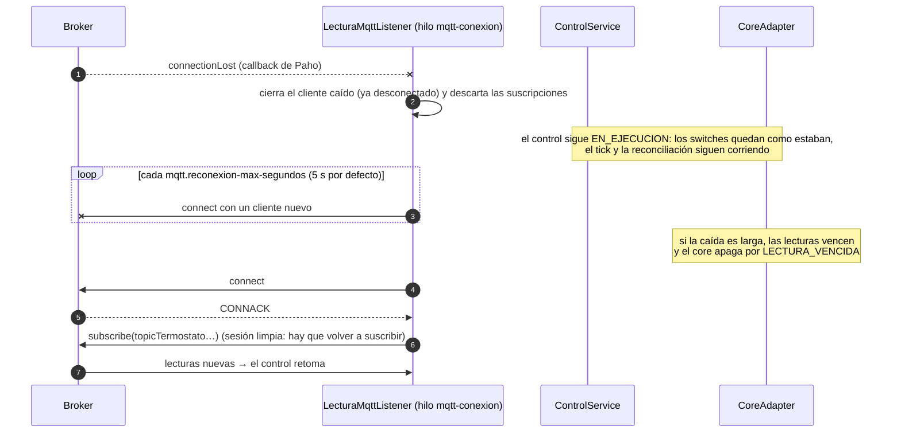
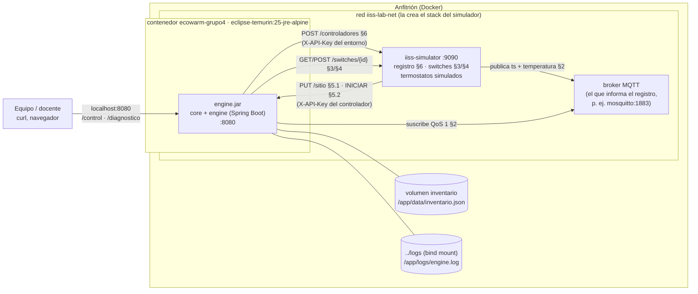

# Arquitectura del controlador EcoWarm — modelo 4+1

Se documenta en forma incremental con la técnica 4+1 de Kruchten. En la **Iteración 4** se
presentaron la **vista lógica** y los **diagramas de secuencia** del manejo de eventos. En la
**Iteración 5** se completa la **vista de procesos** con el manejo de fallas, se agregan los
escenarios de falla (§2.5 y §2.6) y se actualiza la vista de desarrollo con los tests de
integración. En la **Iteración 6** se agrega la **vista física** (§6).

Tras la revisión docente de la iteración 5 (tarjetas T4, T5, T7 y T7b) las vistas describen el diseño
actual: el core contiene el modelo y la función pura `decidir`, y el estado del control (situación y
estado de ejecución) lo guarda `CoreAdapter` en el engine.

| Vista | Estado | Dónde |
|---|---|---|
| Lógica | ✅ Iteración 4, actualizada en la 5 (diseño actual, T11a) | §1 |
| Escenarios (+1): secuencias de eventos | ✅ Iteración 4 + fallas en la 5 (diseño actual, T11a) | §2 |
| Procesos | ✅ Iteración 5 (diseño actual, T11a) | §3 |
| Tiempo del control: relojes, `ts`, vigencia, tick y re-sincronización | ✅ Iteración 5 (T14) | §4 |
| Desarrollo | ✅ Iteración 5, completada en la 6 (tests actuales, T11) | §5 |
| Física: despliegue en Docker, red del simulador y persistencia | ✅ Iteración 6 (T11) | §6 |

Los diagramas están en Mermaid (GitHub los dibuja).

---

## 1. Vista lógica

### 1.1 Contexto

El controlador está entre los termostatos (MQTT), los switches (REST) y quien lo opera (REST).
En integración, el **entorno** (simulador de la cátedra o `ecowarm-check`) juega todos esos
papeles y además ofrece el registro (§6 del estándar).



### 1.2 Módulos

| Módulo | Responsabilidad | Depende de |
|---|---|---|
| **core** | Decidir qué habitación recibe energía, con un modelo interno del estado, los estímulos y las decisiones. El modelo son los records y enums de `core.model` (`EstadoHabitacion`, `Estimulo`, `Decision`, `Sitio`, `ConfiguracionHabitacion`, `ParametrosControl`, `FranjaHoraria`, `Accion`, `Motivo`, `DiasTarifa`); la decisión es la función pura `Core.decidir`. El core **no guarda estado** entre llamadas: recibe la situación por parámetro. Sin comunicación externa, sin reloj del sistema, sin azar. | nada (solo JUnit en test) |
| **engine** | Conectar el core con el mundo: MQTT, REST entrante y saliente, persistencia, registro, reloj del control y eventos temporales. Guarda el estado del control en `CoreAdapter` (temperaturas, instantes de lectura, sitio, reloj, última decisión, estado de ejecución) y se lo pasa a `Core.decidir`. | core, Spring Boot, Paho |

La dirección de dependencia la impone Maven: `core` no tiene dependencias de producción, así que
el compilador impide que importe algo del engine.

### 1.3 Core — diagrama de clases



`Core` solo tiene campos finales (el criterio y los parámetros), así que no tiene estado y se puede
compartir entre hilos. Los `Estimulo` son parte del modelo del core (`core.model`), pero no los
procesa el core: los procesa `CoreAdapter.procesar` en el engine (§1.4), con un `switch` exhaustivo
sobre la interfaz `sealed`.

**Estado vs decisión.** El estado del control vive en el engine, en `CoreAdapter`: sitio y
configuración de las habitaciones, la última temperatura válida y el instante de cada lectura, el
reloj del control (`ahora`), el factor de tiempo y la última decisión de cada habitación (que dice
cuáles están encendidas, lo que necesitan la histéresis y el margen del criterio). Ante cada estímulo,
`CoreAdapter.procesar` actualiza ese estado, arma la situación actual —sitio, habitaciones, un
`EstadoHabitacion` por habitación (temperatura, cuándo se midió, si está encendida), hora del control
y factor de tiempo— y se la pasa por parámetro a `Core.decidir`. El core no guarda nada entre
llamadas: es una función pura, y la misma situación da siempre las mismas decisiones. Antes de guardar
una lectura, el adaptador le pregunta al core si la temperatura es válida (`Core.lecturaValida`:
finita y dentro del rango físico del sensor, de −40 °C a 85 °C).

**La función de decisión** (`Core.decidir`) es pública y recibe por parámetro todo lo que usa, salvo
el criterio y los parámetros de control, que fija el constructor. Se recalcula entera ante cada
estímulo, en tres pasos (con `ahora` en null, todavía sin hora del control, no hay punta ni
vencimientos):

1. **Necesidad** de cada habitación, en este orden: sin lectura → `SIN_LECTURA`; lectura más vieja
   que la vigencia (en tiempo de control, sin escalar por el factor: T8c) → `LECTURA_VENCIDA`; temperatura ≥ umbral →
   `SATISFECHA` (umbral = esperada si está encendida, esperada − histéresis si está apagada);
   potencia > contratada → `EXCEDE_CONTRATADA`; si no, **tiene déficit**.
2. **Tarifa**: si la hora del control cae en la franja punta, todas las que tienen déficit →
   `TARIFA_PUNTA`.
3. **Reparto**: las que tienen déficit se ordenan con el `CriterioPrioridad` y se les asigna la
   potencia contratada en ese orden (`CALEFACCIONANDO`); la que no entra → `SIN_POTENCIA_DISPONIBLE`
   y se sigue con la siguiente (una grande no bloquea a una chica que sí entra).

**Criterio de prioridad** (`MayorDeficitPrimero`): mayor déficit (esperada − actual) primero; la que
ya está encendida suma un margen de 0.5 °C (anti-oscilación: se turnan en vez de alternar en cada
lectura); desempate por id. Es no azaroso y justificable: "la que más lejos está de su objetivo es la
que más necesita la energía ahora".

### 1.4 Engine — diagrama de clases



Las dependencias del control van en un solo sentido: `ControlService` → `CoreAdapter` → `Core`. El
adaptador nunca llama a `ControlService` y el core no conoce a nadie del engine.

Decisiones de diseño relevantes:

- **Un solo punto de contacto con el core** (`CoreAdapter`), que además es el único dueño del estado
  del control. El core no tiene estado, pero el adaptador sí, y le llegan estímulos de MQTT, del
  temporizador y de REST: por eso sus métodos son `synchronized` y procesan un estímulo por vez. La
  comunicación con los switches corre aparte, en su propio hilo (ver §3), para que nadie espere a la
  red.
- **Un solo estado de ejecución** (tarjetas T7 y T7b). Si el control está en ejecución lo dice
  `CoreAdapter.enEjecucion()`, que cambia con `iniciar()` y `detener()`. `ControlService` le delega
  (`ControlService.enEjecucion()` devuelve `adaptador.enEjecucion()`) y no guarda una copia: su campo
  `reloj` solo da la hora (y queda con el último INICIAR después de DETENER). Detenido, el adaptador
  guarda lo que llega (por ejemplo, un `PUT /sitio`) pero **no decide** ni comanda ningún switch: su
  reloj es el del último INICIAR y una decisión con esa hora sería engañosa. Decide en `iniciar()`,
  con el reloj ya re-sincronizado; mientras tanto `/diagnostico` muestra la última decisión tomada
  en ejecución (o ninguna, si nunca se inició).
- **Última decisión vs estado conocido.** El adaptador recuerda la última decisión de cada habitación y
  el último estado *conocido* de su switch (por la respuesta del comando o por la consulta §4), y solo
  comanda cuando difieren. La reconciliación periódica corrige un switch que reinició
  (`DESCONOCIDO`), que alguien movió a mano o cuyo comando se perdió.
- **El reloj lo pone el engine.** `ControlService` mantiene el `RelojControl` (§5.2) y estampa cada
  estímulo con la hora del control: el Tick con `ahora`, y la lectura con el instante que da
  `RelojControl.instanteDeLectura` a partir del `ts` del payload (§2.2). El core nunca lee el reloj del
  sistema: decide con la hora que recibe por parámetro, también con tiempo acelerado.
- **Inventario como única fuente de verdad**, persistido en un archivo JSON con escritura atómica. El
  ABM de habitaciones opera sobre el mismo inventario.
- **Desacople por evento** (`InventarioAplicado`): el inventario no conoce a quién le interesa; el
  control y el listener MQTT lo adoptan en caliente.
- **La potencia contratada se cuida también en la red** (Iteración 5). El core nunca decide más
  de la contratada, pero los comandos pueden fallar. Por eso en cada pasada el adaptador manda
  primero los OFF y después los ON, y retiene un ON si, contando como encendida toda habitación
  cuyo switch no confirmó OFF, se superaría la contratada (ver §2.5).

---

## 2. Escenarios (+1): secuencias del manejo de eventos

### 2.1 Arranque, registro e inicio del control (§6, §5.1, §5.2)



### 2.2 Llega una lectura de temperatura (evento MQTT)



Una lectura recorre **5 pasos**, cada uno con una responsabilidad: (1) `messageArrived`, callback de Paho con el único try/catch; (2) `procesarMensaje`, que resuelve la habitación por el topic y parsea el payload (se prueba sin broker); (3) `ControlService.alRecibirLectura`, dueño del reloj del control; (4) `CoreAdapter.procesar`, dueño del estado y del estado de ejecución (T7b); (5) `Core.decidir`, la función pura. Antes eran 10: `CoreClient` y el `procesar` del core, que guardaba un estado duplicado, se eliminaron (tarjetas T4, T5 y T7).

**Instante de la lectura (`ts`, tarjetas T8, T8b y T24b).** El `ts` (epoch con 3 decimales, §2) se lee exacto con `BigDecimal` y se lleva a la hora del control. El estándar no fija su escala y llegan las dos: en **hora real**, que se convierte con la fórmula del §5.2 `tsControl = fechaHora + (ts − iniciadoEn) × factorTiempo` (donde `iniciadoEn` es la hora real en que llegó el INICIAR), o **ya en hora del control**, como lo manda el simulador de la corrida del 2026-11-04. `RelojControl.tsEnHoraDelControl` se queda con la interpretación más cercana a la hora actual del control: a ×60 las dos quedan a horas o meses de distancia, así que la equivocada nunca gana (ver §4.2). La multiplicación es sobre el tiempo transcurrido, no sobre la hora entera. Ejemplo: INICIAR a las 13:00 reales con `fechaHora = 13:00` y factor 2; una lectura con `ts = 13:05` reales son 5 min × 2 = 10 min, así que su hora del control es 13:10 (con `fechaHora = 08:00` daría 08:10). Ese instante es el que se usa para el vencimiento y para descartar las lecturas fuera de orden. Las reglas (`RelojControl.instanteDeLectura`):

| `ts` (ya en hora del control) | Qué pasa | Por qué |
|---|---|---|
| no vino | se guarda con la hora del control | la temperatura vale igual |
| en el futuro | se guarda con la hora del control | reloj del termostato adelantado: guardado tal cual, no vencería a tiempo |
| dentro de la vigencia | se guarda con el `ts` convertido | el caso normal (llega milisegundos después de medirse) |
| más viejo que la vigencia | **se descarta** y se cuenta en `/diagnostico` (`TS_VENCIDO`, D8) | un dato obsoleto no sostiene la calefacción; sellarlo con la hora actual haría que la próxima lectura buena pareciera fuera de orden |
| anterior a la última guardada | **se descarta** y se cuenta (`FUERA_DE_ORDEN`) | hay un dato más nuevo |

Cada descarte deja además una línea INFO en el log (son excepcionales): habitación, motivo, el `ts` original y su valor en hora del control (en `TS_VENCIDO`; en `FUERA_DE_ORDEN` el adaptador solo conoce el instante ya convertido) y la hora del control en ese momento.

La vigencia se mide en tiempo de control, sin escalar por el factor (T8c), tanto acá como en `Core.decidir`. Un desfase entre el reloj real del simulador y el del controlador se multiplica por el factor (2 s con factor 30 son 1 min de control): `RelojControlTest.desfaseDeReloj_noDescartaNiDesordena` muestra que con ±2 s a ×30 ninguna lectura se descarta ni retrocede; en Docker sobre el mismo host los dos comparten el reloj, y se verifica contra el simulador en T13.

### 2.3 Evento temporal: entrada y salida de la franja punta



**Tiempo acelerado y atraso del corte (T12).** Cada tick avanza `control.tick-ms` (1 s) de tiempo de control, así que el período real es `max(10 ms, tickMs / factor)` y se reprograma en cada INICIAR. El corte o la restitución se atrasan como mucho un tick en tiempo de control, más la latencia de la pasada de switches:

| Factor | Período real del tick | Atraso máximo del corte (tiempo de control) |
|---|---|---|
| 1 | 1 s | 1 s |
| 30 | 33 ms | 1 s |
| 100 | 10 ms | 1 s |
| 600 | 10 ms (mínimo) | 6 s |

Con el tick fijo de antes (1 s real) el atraso era de un tick real: 30 s de control a ×30 y 10 min a ×600. `TiempoAceleradoTest` arranca a ×600 cinco minutos antes de la punta y verifica el corte en menos de 1 s real (y con menos de 1 min de control de atraso); y lo mismo con la restitución al salir. Con el tick sin escalar los dos tests fallan (el corte llega a los ~1025 ms reales).

**Corte anticipado (T24e).** Aun con el tick escalado, el corte llegaba tarde: en el escenario E11 del simulador oficial (`ecowarm-run`, ×60) la pasada consultó y apagó los 5 switches entre las 17:00:00 y las 17:00:02 de control, porque a ×60 cada milisegundo real son 60 ms simulados, y la expectativa "en punta no se enciende nada" falló. Por eso el core trata la punta como si empezara `control.anticipacion-punta-segundos` antes (60 s de tiempo de control por defecto, 1 s real a ×60): a las 16:59 ya decide `TARIFA_PUNTA` y los OFF llegan antes de las 17:00. La salida **no** se adelanta: a las 23:00 se restituye como antes (`DecidirTest.anticipacion_cortaAntesYRestituyeALaHora`). El costo es calefaccionar un minuto menos antes de cada punta.

### 2.4 Cambio de configuración en caliente (`PUT /sitio` con el control en ejecución)



### 2.5 Falla el OFF que liberaba potencia (Iteración 5)

Dos habitaciones de 1 kW con 1 kW contratado: el core pasa la energía de `dorm` a `living`.



Lo verifica `FallaSwitchTest`.

### 2.6 El broker MQTT cae y vuelve (Iteración 5)



Lo verifican `FallaBrokerMqttTest` y `TermostatoCaidoTest`.

No se usa la reconexión automática de Paho. Su espera entre reintentos es un campo estático,
compartido por todos los clientes de la JVM, que se duplica en cada intento fallido. Además, un
cliente que se cierra en medio de un reintento queda vivo y sigue reconectándose. Reconectar desde
el hilo propio deja la espera fija y garantiza que al apagar no quede ningún cliente.

---

## 3. Vista de procesos (Iteración 5)

| Hilo | Origen | Qué hace |
|---|---|---|
| Tomcat (HTTP) | requests REST | `PUT /sitio`, `INICIAR`/`DETENER`, consultas |
| Paho callback | broker MQTT | `messageArrived` → `procesarMensaje` → `ControlService.alRecibirLectura` |
| `mqtt-conexion` | propio (`LecturaMqttListener`) | conexión y reconexión tras una caída (reintento cada 5 s, cliente nuevo) y (re)suscripciones (nunca desde el hilo de Paho: deadlock) |
| `control-temporizador` | propio (`ControlService`) | tick cada `control.tick-ms` de tiempo de control, o sea cada `max(10 ms, tickMs / factor)` reales (T12; se rearma en cada INICIAR), reconciliación cada `control.reconciliacion-segundos` (15 s) de tiempo de control, o sea cada `max(1 s, 15 s / factor)` reales (T36), y un resumen en el log cada `control.resumen-segundos` (30 s) reales; existe solo mientras el control está en ejecución |
| `registro-entorno` | propio (`RegistroEntorno`) | registro §6 con reintentos exponenciales |
| `switches` | propio (`CoreAdapter`) | todo el I/O con los switches: consultas §4 y comandos §3, en pasadas; primero los sanos y después los que vienen fallando (T37) |
| `main` | Spring | al quedar lista la aplicación, `RegistroEntorno.arrancar` recupera el inventario guardado y lanza `registro-entorno` |

**Candados.** Los estímulos convergen en `CoreAdapter`, el único que toca el core y el único dueño del
estado del control, incluido el estado de ejecución. Sus métodos públicos son `synchronized`; el core
no tiene estado y se llama dentro de ese bloqueo. `ControlService` tiene su propio candado (`iniciar`,
`detener`, `alRecibirLectura`, `aplicarInventario` y `tick` son `synchronized`), para que una lectura
estampada con el reloj viejo no se procese después de que INICIAR re-sincronizó el reloj. Los
candados se toman siempre en el mismo orden (`InventarioService` → `ControlService` → `CoreAdapter`,
ya que el evento `InventarioAplicado` se publica en forma sincrónica) y nunca al revés, porque el
adaptador no llama a `ControlService`: no hay deadlock. `LecturaMqttListener` usa un candado propio
solo para la conexión y las suscripciones; el callback de Paho no lo toma.

El core se llama dentro del bloqueo, pero **la red hacia los switches no**: cada estímulo actualiza la
última decisión, pide una pasada al hilo `switches` y vuelve. La pasada toma el candado del adaptador solo para
leer o actualizar el estado, y antes de cada comando vuelve a mirar el estado de ejecución: un DETENER
que llega durante una pasada corta los comandos que faltan. Así `INICIAR` y `PUT /sitio` responden sin
esperar a los switches —importante porque en el registro §6 el entorno nos da `INICIAR` antes de
responder, y es él mismo quien sirve los switches: esperar ahí era un bloqueo circular— y un switch
lento no demora al core, a MQTT ni al API. Los pedidos que llegan durante una pasada se juntan en una
sola pasada siguiente, que usa la decisión vigente en ese momento.

**Un switch colgado no traba a los demás (T37).** Dentro de una pasada las llamadas son de a una:
mientras se espera a un switch que no responde, no se atiende a ningún otro. Una prueba de estrés
(`EstresTest`) lo mostró: a ×60, con 3 switches colgados a las 16:54, el switch sano seguía
encendido a las 17:54 de control. Cada colgado trababa el hilo 10 s (10 min de control), la espera
de 5 s entre reintentos vencía antes de terminar la pasada, y la siguiente volvía a empezar por los
colgados. Decidimos no paralelizar (A5, A19) y acotar la espera con tres reglas:

1. **Timeout en tiempo de control.** Los configurados (2 s de conexión, 10 s de respuesta) valen con
   factor 1; con el control acelerado se dividen por el factor, con un piso de 0,5 s reales y nunca
   más que lo configurado (`ClienteSwitchRest.ajustarAlFactor`, en cada INICIAR). A ×60, 0,5 s.
2. **Primero los sanos.** Cada pasada consulta y comanda (OFF y después ON) los switches que no vienen
   fallando, y recién después los que fallaron y todavía no volvieron a responder.
3. **Corte por cambio de decisión.** Antes de llamar a un switch que viene fallando, si cambió la
   acción decidida de alguna habitación (por ejemplo, empezó la punta), la pasada se corta: la que
   pidió ese cambio ya está encolada y empieza de nuevo por los sanos.

Así un switch sano espera, como mucho, una llamada en curso a uno que no responde: 0,5 s reales a
×60 (30 s de control), dentro del minuto de corte anticipado de la punta (T24e). Con factor 1 la
espera puede ser de hasta 12 s por switch colgado (L9). La potencia contratada sigue cuidada entre
grupos: un switch que no confirmó OFF cuenta como encendido para retener un ON (§2.5).

### 3.1 Manejo de fallas

| Falla | Qué hace el controlador | Hilo | Test |
|---|---|---|---|
| Broker caído al arrancar | reintenta cada 5 s; al conectar se suscribe a los topics del inventario | `mqtt-conexion` | `ApiEstandarTest`, `FallaBrokerMqttTest` |
| Broker cae durante la ejecución | se descarta el cliente caído y se reintenta cada 5 s con uno nuevo; al volver se re-suscribe. El control sigue y no toca los switches por la caída | `mqtt-conexion` | `FallaBrokerMqttTest` |
| Se pierden mensajes o llegan corruptos | un payload inválido se descarta; una temperatura fuera de rango, una lectura fuera de orden o con `ts` más viejo que la vigencia también, y estas tres se cuentan en `/diagnostico` (`FUERA_DE_RANGO`, `FUERA_DE_ORDEN`, `TS_VENCIDO`); la decisión usa la última lectura válida mientras esté vigente | Paho callback | `PerdidaMensajesTest`, `PayloadTermostatoTest`, `CoreAdapterEstimulosTest` |
| Termostato deja de publicar | la lectura vence (10 min de tiempo de control, sin escalar por el factor: T8c) y el core apaga por `LECTURA_VENCIDA` | `control-temporizador` | `TermostatoCaidoTest` |
| Switch no responde o da error | timeout (2 s de conexión, 10 s de respuesta, divididos por el factor con piso de 0,5 s: T37); no se le reintenta por 5 s; mientras no vuelva a responder, cada pasada lo atiende después de los sanos; la reconciliación lo corrige al volver | `switches` | `FallaSwitchTest`, `CoreAdapterTest`, `ClienteSwitchRestTest` |
| Varios switches colgados a la vez cruzando el inicio de la punta | los sanos se apagan a tiempo: esperan como mucho una llamada en curso (0,5 s reales a ×60) porque la pasada se corta al cambiar la decisión y vuelve a empezar por ellos (T37) | `switches` | `EstresTest` |
| Falla el OFF que liberaba potencia | se retiene el ON que superaría la contratada hasta que el OFF se confirme (§2.5) | `switches` | `FallaSwitchTest` |
| Switch reiniciado o movido a mano | la consulta §4 lo ve distinto de la última decisión y lo vuelve a comandar; a ×60, en segundos reales (T36) | `switches` | `CoreAdapterTest`, `ReconciliacionEscaladaTest` |
| Switch que responde fuera de contrato (no JSON, `estado` en minúscula, otro `Content-Type`) | una consulta que no es JSON cuenta como falla y el log muestra lo que mandó; un comando que responde 2xx se toma como aplicado aunque el cuerpo no sea JSON (la reconciliación lo verifica); el `estado` se lee sin importar mayúsculas y un JSON con otro `Content-Type` se acepta | `switches` | `ClienteSwitchRestTest` |
| Entorno que tarda en levantar | el registro reintenta con espera exponencial (2, 4, 8 … 30 s) | `registro-entorno` | — |
| `CONTROLADOR_BASE_URL` que el entorno no puede alcanzar (`localhost` con el entorno en otra máquina, IP mal escrita) | aviso `WARN` al arrancar, antes de registrarse: el registro igual responde 201 y el error solo se notaría porque nunca llega el `PUT /sitio` (corrida del 2026-10-28) | `main` | `RegistroEntornoTest` |
| Reinicio del controlador | el inventario se recupera del archivo JSON; uno corrupto no impide arrancar | `main` | `RepositorioInventarioTest` |
| Un switch que no prende (acepta el ON y sigue apagado, o el ON falla y la consulta lo muestra apagado) | la habitación queda `OFF` con `SWITCH_NO_RESPONDE` y su potencia pasa a las demás; se reintenta tras una espera que se duplica (30 s, hasta 10 min) (A17) | `switches` | `CoreAdapterTest` |

### 3.2 Qué deja el log de una corrida

Una corrida contra el simulador tiene que poder verificarse después solo con el log, sin cambiar el comportamiento del control. En INFO quedan:

- **Sitio aplicado** (`CoreAdapter.configurar`, en cada `PUT /sitio` o ABM y en cada INICIAR): potencia contratada, franja punta (desde-hasta y días), zona y, por habitación, temperatura esperada, kW y switch.
- **Decisión** por habitación cuando cambia la acción **o el motivo**: así se ve la entrada a la punta (`SATISFECHA` → `TARIFA_PUNTA`) o la carga limitada (`SIN_POTENCIA_DISPONIBLE`) aunque el switch siga en OFF.
- **Lecturas descartadas** (`TS_VENCIDO`, `FUERA_DE_ORDEN`), con el `ts` y la hora del control (ver [§2.2](#22-llega-una-lectura-de-temperatura-evento-mqtt)), y las fuera del rango del sensor (`FUERA_DE_RANGO`), con el valor recibido (D11).
- **Resumen** cada `control.resumen-segundos` reales (30 por defecto, 0 lo desactiva), solo en ejecución: hora del control con el día de la semana, habitaciones en ON, potencia comprometida contra la contratada y habitaciones por motivo.
- Comandos y fallas de switches, conexión MQTT, INICIAR y DETENER.

Cada lectura recibida (`[TEMPERATURA]`) va en DEBUG: en una corrida real eran el 95 % de las líneas. Se sube con `logging.level.uy.edu.utec.iiss.engine.mqtt.LecturaMqttListener=DEBUG`.

## 4. Tiempo del control

El tiempo del sistema es simulado: el simulador genera las lecturas y puede pasar a modo acelerado enviando un factor (por ejemplo, 10 min reales que emulan 5 h son factor 30). Los mensajes MQTT llegan y se procesan en tiempo real, pero con intervalos irregulares, porque el simulador provoca a propósito switches caídos, lecturas atrasadas y relojes desincronizados. Por eso el controlador **no** toma la hora de la máquina donde corre: la saca del contexto que recibe, el INICIAR y el `ts` de cada lectura.

### 4.1 Tres relojes, un trabajo cada uno

```
(a) reloj del sistema   Clock relojReal = Clock.systemUTC()   (CoreConfig)
        |  solo mide duraciones (y esperas de reintento a los switches)
        v
(b) reloj del control   RelojControl
        |  ahora = fechaHora + (tiempoRealTranscurrido × factorTiempo)
        |  única fuente de "qué hora es" para decidir (tarifa, vencimiento, ticks)
        ^
(c) ts del termostato   solo fecha la medición, nunca mueve la hora del control
                        (en hora real o ya en la escala de (b): se toma la que cae más cerca de ahora)
```

**Fórmula** (estándar v2 §5.2), válida desde el INICIAR:

```
ahora = fechaHora + (tiempoRealTranscurrido × factorTiempo)
tiempoRealTranscurrido = Duration.between(iniciadoEn, relojReal.instant())
```

`iniciadoEn` es la hora real en que llegó el INICIAR. `RelojControl.aTiempoDeControl` aplica la fórmula a cualquier instante real, y `RelojControl.ahora` la aplica a la hora actual. La zona (`America/Montevideo`, fija) solo sirve para leer la franja tarifaria en hora local.

### 4.2 Instante de una lectura (`ts`)

El `ts` es un epoch con 3 decimales; se parsea exacto con `BigDecimal`. El estándar no dice en qué escala viene, y en la práctica llegaron las dos:

- en **hora real** (lo que nos indicó el docente): se lleva a la hora del control con la misma fórmula,
  ```
  tsControl = fechaHora + (ts − iniciadoEn) × factorTiempo
  ```
- **ya en hora del control** (lo que mandó el simulador en la corrida del 2026-11-04: `ts` 13:00:34Z con `fechaHora` 13:00:00Z a ×60): se usa tal cual.

`RelojControl.tsEnHoraDelControl` calcula las dos y se queda con la más cercana a `ahora` (T24b). A ×60 la equivocada queda a horas o meses de distancia; con factor 1 y `fechaHora` igual a la hora real coinciden. Antes de T24b el `ts` se convertía siempre: con ese simulador cada lectura caía en agosto y se descartaba como `TS_VENCIDO`, y el control pasó toda la corrida sin lecturas (`RelojControlTest.tsEnHoraDelControl_seUsaTalCual` usa esos `ts`; `FallaBrokerMqttTest.caidaCorta_tsEnHoraDelControl_noVencenLasLecturas` reproduce la corrida con una caída corta del broker).

La multiplicación se aplica al **tiempo transcurrido** desde el INICIAR, no a la hora entera. Ejemplo: INICIAR a las 13:00 reales con `fechaHora = 13:00` y factor 2. Una lectura con `ts = 13:05` reales lleva 5 min transcurridos × 2 = 10 min, así que su hora del control es 13:10. Con `fechaHora = 08:00` sería 08:10 (`RelojControlTest.conversion_factorDos_mismaHora` y `conversion_factorDos_otraFechaHora`).

Reglas (`RelojControl.instanteDeLectura` y `CoreAdapter`), con el detalle en la tabla del [§2.2](#22-llega-una-lectura-de-temperatura-evento-mqtt):

- sin `ts`, o con un `ts` que ya convertido queda en el futuro: se usa `ahora`. La temperatura vale igual, y un termostato adelantado no puede adelantar el control;
- `ts` más viejo que la vigencia: se descarta y se cuenta en `/diagnostico` como `TS_VENCIDO` (D8);
- `ts` anterior a la última lectura guardada: se descarta y se cuenta como `FUERA_DE_ORDEN`;
- en cualquier otro caso: se guarda con el `ts` convertido.

### 4.3 Vigencia de una lectura

Una lectura vale `control.vigencia-lectura-segundos` (600 s) de **tiempo de control**, sin escalar por el factor (`Core.lecturaVencida`). La misma regla la usan `Core.decidir`, el descarte del `ts` viejo y la re-sincronización. Con factor 30, 600 s de control son 20 s reales: un termostato caído se detecta en la prueba acelerada. Si la vigencia se escalara por el factor, serían 5 h simuladas y ninguna lectura vencería en toda la corrida.

### 4.4 Tick

Cada tick avanza `control.tick-ms` (1 s) de tiempo de control, así que su período real es `max(10 ms, tickMs / factor)` (`ControlService.periodoTickMs`). El temporizador se rearma en cada INICIAR, por si cambió el factor. El corte o la restitución de la franja punta se atrasan como mucho un tick de tiempo de control: la tabla de atrasos por factor está en el [§2.3](#23-evento-temporal-entrada-y-salida-de-la-franja-punta).

### 4.5 INICIAR repetido (re-sincronización)

Un INICIAR sobre un control en ejecución no es error: re-sincroniza (§5.2). `ControlService.iniciar`:

1. configura el sitio en el adaptador, si hay inventario;
2. manda un Tick con la hora del reloj **anterior**, así se cuenta también el tiempo que el control estuvo detenido;
3. manda la Sincronización: `CoreAdapter.sincronizarReloj` olvida las lecturas que ya estaban vencidas con el reloj anterior (la habitación queda `SIN_LECTURA`) y marca las vigentes con la hora nueva (D7). Así un dato viejo no revive, y las lecturas que lleguen después de un salto hacia atrás no se toman como fuera de orden;
4. reemplaza el reloj, pone al adaptador en ejecución (que decide con el reloj nuevo; detenido no decidía en los pasos 1 a 3) y rearma el tick con el factor nuevo.

`iniciar`, `alRecibirLectura` y `tick` son `synchronized` en `ControlService`: una lectura sellada con el reloj viejo no se procesa después de la re-sincronización.

### 4.6 Qué dice la letra y qué decidimos

La letra son los PDF de las iteraciones 1 a 5 y [`interop-v2.md`](../api/interop-v2.md). Lo que ella no dice son **decisiones del equipo** y se documentan como tales. El registro completo de decisiones, con contexto, alternativas y consecuencias, está en [`decisiones.md`](decisiones.md).

| Tema | Qué dice la letra (fuente) | Decisión del equipo | Motivo |
|---|---|---|---|
| Sincronización | Sincronizar con `fechaHora` al INICIAR (§5.2) | Igual que la letra | — |
| Fórmula del tiempo | `ahora = fechaHora + tiempoReal × factorTiempo` (§5.2) | Igual que la letra | — |
| `factorTiempo` | Mayor que 0; ausente = 1 (§5.2) | Igual que la letra | — |
| INICIAR repetido | Re-sincroniza (§5.2) | Igual que la letra, y las lecturas vencidas se olvidan (D7) | Un dato viejo no debe volver a contar como reciente |
| Tarifa punta | Por hora y día de semana, en "hora local" (it. 1 a 5) | Igual que la letra | — |
| Corte y restitución | Cortar al entrar en punta y restituir al salir (it. 1 a 5) | Igual que la letra | — |
| Formato del `ts` | Epoch en segundos con 3 decimales (§6) | Se parsea exacto con `BigDecimal` | Evitar el redondeo que marcó el docente |
| Escala del `ts` | No la define (§2) | Se aceptan las dos: hora real (convertida con la fórmula del §5.2) o ya en hora del control; se toma la más cercana a `ahora` (T24b) | El docente indicó hora real, pero el simulador del 2026-11-04 lo mandó en hora del control y con la conversión fija se descartaban todas las lecturas |
| Hora local | "Hora local del sistema" | Uruguay (`America/Montevideo`), fija, sin `systemDefault()` | Confirmado por el docente y por la [corrida del 2026-10-28](../tests/corrida-simulador/2026-10-28/README.md): el simulador cruza la punta con `fechaHora` en hora de Montevideo |
| Vigencia de lecturas | No la define | 600 s de tiempo de control, sin escalar por el factor | Un solo reloj; escalada, con factor 30 ninguna lectura vence en 5 h simuladas |
| Frecuencia de publicación | Depende del escenario del simulador (docente) | No se asume ninguna | El simulador provoca atrasos y caídas a propósito |
| `ts` viejo | No lo define | Se descarta y se cuenta en `/diagnostico` (D8) | Un dato obsoleto no debe sostener la calefacción |
| Período del tick | No lo define | 1 s de tiempo de control: `max(10 ms, tickMs / factor)` reales | Con un tick fijo de 1 s real, a ×600 el corte se atrasaba hasta 10 min. Se descartó programar eventos en los bordes de la franja: suma complejidad sin necesidad |
| Canal del factor en la it. 5 | "Parámetro al inicio" | `factorTiempo` del INICIAR; el paso a acelerado llega como un INICIAR que re-sincroniza | Es el único canal del contrato; confirmado en la [corrida del 2026-10-28](../tests/corrida-simulador/2026-10-28/README.md) (`factorTiempo = 60` en cada INICIAR) |

### 4.7 Riesgos (y la pregunta que se cerró)

- **Cerrada:** el paso a modo acelerado llega como un INICIAR con `factorTiempo`. En la [corrida del 2026-10-28](../tests/corrida-simulador/2026-10-28/README.md) cada escenario fue `PUT /sitio`, INICIAR con factor 60 y DETENER; el cruce de punta se restituyó exactamente a las 23:00 de control.
- **Desfase entre relojes.** La conversión del `ts` supone que el reloj real del simulador y el del controlador coinciden (en Docker sobre el mismo host comparten el reloj). Un desfase se multiplica por el factor: 2 s con factor 30 son 1 min de control. `RelojControlTest.desfaseDeReloj_noDescartaNiDesordena` muestra que con ±2 s a ×30 ninguna lectura se descarta ni retrocede.
- **Vigencia recuperada al re-sincronizar.** Una lectura vigente marcada con la hora nueva recupera la vigencia completa: un dato de 9:59 min vuelve a valer 10 min. La alternativa es conservar su antigüedad (`nuevo − (ahoraViejo − instante)`); queda como mejora posible.
- **Re-INICIAR con el control en ejecución.** Son pasos separados (configurar, Tick, Sincronización). Entre ellos el hilo de switches podría enviar un comando decidido con el reloj anterior, que se corrige enseguida. Riesgo bajo.
- **Lectura medida justo antes del INICIAR.** Puede descartarse como `FUERA_DE_ORDEN` o `TS_VENCIDO`, porque con factor alto la latencia se multiplica. No afecta: la siguiente lectura entra bien, y el descarte queda contado en `/diagnostico`.

## 5. Vista de desarrollo

```
modules/
├── core/      uy.edu.utec.iiss.core          Core (decidir, lecturaValida), CriterioPrioridad,
│                                             MayorDeficitPrimero
│              uy.edu.utec.iiss.core.model    Accion, ConfiguracionHabitacion, Decision, DiasTarifa,
│                                             EstadoHabitacion, Estimulo, FranjaHoraria, Motivo,
│                                             ParametrosControl, Sitio
│              src/test                       DecidirTest (por situación), MayorDeficitPrimeroTest,
│                                             ModeloTest, CoreTestFixtures (utilitarios)
└── engine/    uy.edu.utec.iiss.engine        EngineApplication
               ├── inventario/  §1 y §5.1: modelo, validación, persistencia, evento InventarioAplicado
               ├── control/     §5.2: ControlService (INICIAR/DETENER, temporizador),
               │                RelojControl, EstadoControl
               ├── adaptador/   CoreAdapter (único puente con el core y dueño del estado del control)
               ├── switches/    §3/§4: ClienteSwitch, ClienteSwitchRest, EstadoSwitch
               ├── mqtt/        §2: LecturaMqttListener, PayloadTermostato
               ├── registro/    §6: RegistroEntorno (registro ante el entorno y arranque)
               ├── rest/        controller/ (Sitio, Habitacion, Control, Diagnostico),
               │                security/ (ApiKeyFilter, X-API-Key), error/ (errores uniformes)
               ├── config/      CoreConfig: armado del core y del adaptador
               ├── util/        Instantes (formato ISO-8601 con milisegundos)
               └── src/test/…/
                   ├── adaptador/   CoreAdapterTest (switches, pasadas, estado de ejecución),
                   │                CoreAdapterEstimulosTest (por estímulos), EstimulosFixtures
                   ├── control/     RelojControlTest, ControlServiceTest (períodos del tick y
                   │                de la reconciliación)
                   ├── switches/    ClienteSwitchRestTest (respuestas fuera de contrato, timeout
                   │                escalado con el factor)
                   ├── inventario/  ValidadorInventarioTest, RepositorioInventarioTest,
                   │                InventarioEjemplo
                   ├── mqtt/        PayloadTermostatoTest, LecturaMqttListenerTest
                   │                (identificador del cliente MQTT)
                   ├── registro/    RegistroEntornoTest
                   ├── rest/        ApiEstandarTest
                   └── integracion/
                                IntegracionBase (contexto Spring + BrokerMqttEmbebido (Moquette)
                                + SwitchesHttpFalsos), ControlCargaTest, ArranqueParadaTest,
                                CambioConfiguracionTest, FallaBrokerMqttTest, PerdidaMensajesTest,
                                FallaSwitchTest, TermostatoCaidoTest, TiempoAceleradoTest,
                                EscenariosSimuladorTest, ReconciliacionEscaladaTest,
                                EstresTest (switches colgados, ×600 y ×3600, 50 habitaciones y
                                fallas combinadas, siempre cruzando las 17:00)
```

Los tests de estímulos (lectura, tick, configuración, INICIAR) eran `CoreTest` hasta la iteración 5;
con el core sin estado pasaron a `CoreAdapterEstimulosTest`, junto con `CoreAdapter.procesar`
(tarjeta T5).

Formato del código: Spotless con google-java-format (AOSP), configurado en el `pom.xml` padre;
`mvn verify` falla si algo no cumple (ver [`docs/calidad/`](../calidad/README.md)).

## 6. Vista física (Iteración 6)

Dónde corre cada pieza, por dónde se comunican y qué sobrevive a un reinicio. El controlador es un
solo proceso Java (core + engine en `engine.jar`) dentro de un contenedor Docker; todo lo demás es
del entorno.

### 6.1 Despliegue en el laboratorio (red del simulador)

Es la configuración de las pruebas de aceptación:
`docker compose -f docker/docker-compose.yml -f docker/docker-compose.lab.yml up -d --build`
(o `./scripts/up.sh lab`).



| Nodo | Imagen / proceso | Puertos | Quién lo levanta |
|---|---|---|---|
| `ecowarm-grupo4` | `eclipse-temurin:25-jre-alpine` + `engine.jar` (build en dos etapas, `modules/engine/Dockerfile`) | 8080 (publicado en el anfitrión) | Nosotros (`docker/docker-compose.yml` + `.lab.yml`) |
| `iiss-simulator` | Simulador de la cátedra | 9090 en la red `iiss-lab-net` | La cátedra (su `docker-compose.yml`) |
| Broker MQTT | Del stack del simulador | 1883 en la red | La cátedra. Su dirección llega en la respuesta del registro: no se configura |

| Comunicación | Protocolo | Dirección | Configuración |
|---|---|---|---|
| Registro §6 | HTTP + `X-API-Key` | controlador → `http://iiss-simulator:9090` | `ENTORNO_URL`, `ENTORNO_API_KEY` |
| Inventario §5.1 e INICIAR/DETENER §5.2 | HTTP + `X-API-Key` | simulador → `http://ecowarm-grupo4:8080` | `CONTROLADOR_BASE_URL` (va en el registro), `API_KEY` |
| Lecturas §2 | MQTT, QoS 1, sesión limpia | broker → controlador | Broker informado por el registro; si no lo informa, `MQTT_BROKER` |
| Switches §3/§4 | HTTP + `X-API-Key` | controlador → `urlSwitch` de cada habitación (el simulador) | `SWITCH_API_KEY` (por defecto la del entorno) |

**Orden de arranque.** El stack del simulador va primero: crea la red `iiss-lab-net`, que el compose
del controlador declara `external`. Si el simulador todavía no responde, el registro reintenta con
espera exponencial (2, 4, 8 … 30 s) y MQTT cada 5 s (§3.1): el orden dentro de la red no importa.

**Qué sobrevive a un reinicio del contenedor.**

| Dato | Dónde | ¿Sobrevive? |
|---|---|---|
| Inventario del sitio | volumen `inventario` → `/app/data/inventario.json` | Sí, también a recrear el contenedor |
| Log | `../logs/engine.log` en el anfitrión (bind mount) | Sí |
| Estado de ejecución y reloj del control | memoria | No: arranca `DETENIDO` hasta el próximo INICIAR ([roadmap L2](roadmap.md)) |
| Lecturas y últimas decisiones | memoria | No: se reconstruyen con las lecturas nuevas y la consulta §4 a los switches |

### 6.2 Otras configuraciones

| Configuración | Cómo se levanta | Diferencias con 6.1 |
|---|---|---|
| **Con el verificador `ecowarm-check`** (primer intento de integración) | `java -jar ecowarm-check.jar` en el anfitrión y `./scripts/up.sh` | El checker hace de simulador, broker y switches en el anfitrión (`:9090`, `:1883`); el contenedor lo alcanza por `host.docker.internal` (`extra_hosts` del compose) |
| **Instalación real** (sin entorno con registro) | `docker compose -f docker/docker-compose.yml up -d` con `ENTORNO_URL` vacío | No hay registro: el broker sale de `MQTT_BROKER` y el inventario se carga con `PUT /sitio`. Los switches son dispositivos de la casa en la red local |
| **Desarrollo** | `mvn verify` / `java -jar modules/engine/target/engine.jar` | Sin Docker. Los tests de integración levantan un broker Moquette y switches HTTP falsos dentro del mismo proceso (§5) |

### 6.3 Requisitos del anfitrión

- Docker con Compose v2. La imagen se compila adentro (Maven + JDK 25), así que no hace falta Java en
  el anfitrión para levantar el controlador; sí para `mvn verify`.
- Puerto 8080 libre (o cambiar el mapeo en el compose y `CONTROLADOR_BASE_URL`).
- Relojes del anfitrión y del simulador sincronizados: el `ts` de las lecturas se convierte con la
  hora real del controlador (§4.2, [roadmap L5](roadmap.md)). En el laboratorio comparten el reloj
  del anfitrión.
