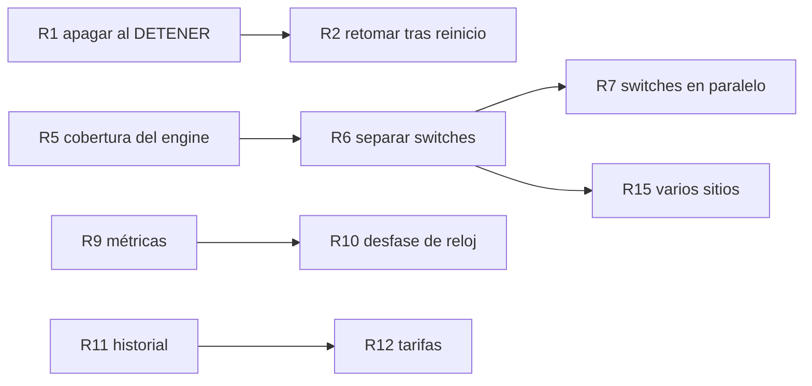

# Limitaciones conocidas y roadmap

Entregable de la iteración 6. Es para el equipo que continúe el desarrollo: qué no hace hoy el
controlador, qué riesgos asumimos a sabiendas y por dónde seguir. Las decisiones que explican cada
limitación están en [`decisiones.md`](decisiones.md) (A1–A18, D1–D12) y en el
[4+1 §4.6](4mas1.md#46-qué-dice-la-letra-y-qué-decidimos).

Cada limitación tiene un id (`L…`) que el roadmap usa para decir qué resuelve cada paso.

---

## 1. Limitaciones conocidas

### 1.1 Comportamiento del control

| Id | Limitación | Impacto | Qué hay hoy |
|---|---|---|---|
| L1 | **DETENER deja los switches como están.** El §5.2 no exige apagar, y decidimos no hacerlo. | Si el control se detiene con habitaciones en ON, quedan prendidas sin supervisión: no se corta la punta ni se respeta la contratada si alguien cambia algo a mano. | Documentado como decisión. El API del controlador no tiene un comando para apagar todo: hay que comandar cada switch directamente (§3). |
| L2 | **Un reinicio del contenedor arranca DETENIDO.** No se guarda si el control estaba en ejecución, ni el reloj. | Tras un corte de luz o un reinicio, nadie controla hasta que el entorno mande un INICIAR. Los switches quedan como estaban (ver L1). | El inventario sí se recupera del archivo (`RepositorioInventario`). `ApiEstandarTest.controlArrancaDetenido` fija el comportamiento. |
| L3 | **Al re-sincronizar, una lectura vigente recupera la vigencia completa** (D7). Una de 9:59 min vuelve a valer 10 min. | Con re-INICIAR seguidos, un termostato caído tarda más en detectarse. | Las lecturas ya vencidas sí se olvidan (D7). Conservar la antigüedad es la alternativa (4+1 §4.7). |
| L4 | **El modo acelerado solo se conoce por el `factorTiempo` del INICIAR.** | Un entorno que acelerara por otro canal dejaría al reloj del control con el factor viejo: tarifa y vencimientos mal calculados. | Es el único canal del contrato (§5.2), y es el que usa el simulador: en la [corrida del 2026-10-28](../tests/corrida-simulador/2026-10-28/README.md) cada escenario llegó como INICIAR con factor 60. |
| L5 | **Los relojes del simulador y del controlador se suponen sincronizados.** Un `ts` en hora real se convierte con la hora real de esta máquina (uno que ya viene en hora del control se usa tal cual, D3). | Un desfase se multiplica por el factor: 2 s a ×30 es 1 min de control. Con desfases grandes, lecturas descartadas como `TS_VENCIDO` o `FUERA_DE_ORDEN`. | En Docker sobre el mismo host comparten reloj. ±2 s a ×30 no descarta nada (`RelojControlTest`). Los descartes se ven en `/diagnostico`. |
| L6 | **El corte de la punta se adelanta un tiempo fijo** (1 min de tiempo de control) para compensar el tick y la latencia de los comandos. | A factores muy altos (×600 o más) el atraso de un tick más los comandos puede superar ese minuto y algún calefactor quedaría encendido unos segundos en punta. A ×1 se calefacciona un minuto menos antes de cada punta. | Tick escalado con el factor (T12) y corte anticipado configurable con `CONTROL_ANTICIPACION_PUNTA_SEGUNDOS` (A16). Con ×60, el simulador oficial no registra consumo en punta (E11). |
| L7 | **Un solo sitio y una sola franja punta**, con zona fija `America/Montevideo`. | No sirve para otro país ni para tarifas con varias franjas o feriados. | La zona se puede cambiar con `CONTROL_ZONA_HORARIA`; la franja aplica a días hábiles (`HABILES`) o a todos (`TODOS`). |
| L8 | **Criterio de prioridad único**: mayor déficit primero. | No se puede priorizar por habitación (por ejemplo, el dormitorio de noche). | `CriterioPrioridad` es una interfaz: se puede agregar otro criterio sin tocar `decidir`. |
| L18 | **Una temperatura fuera de rango se descarta en silencio**, y el rango es el físico del sensor (-40 a 85 °C, extremos incluidos). | Un sensor roto que manda valores imposibles no deja rastro en el log ni en `/diagnostico`. Un valor extremo pero dentro del rango (-40 °C) se toma como real. | Se conserva la última lectura buena hasta que vence (`PerdidaMensajesTest.lecturaFueraDeRango`). |

### 1.2 Comunicación y fallas

| Id | Limitación | Impacto | Qué hay hoy |
|---|---|---|---|
| L9 | **Las llamadas a los switches son de a una.** Mientras se espera a un switch colgado no se atiende a ningún otro. | Un switch sano puede esperar una llamada en curso a uno colgado: con factor 1, hasta 12 s (2 s de conexión + 10 s de respuesta); a ×60, 0,5 s reales (30 s de control). Un switch lento pero vivo que a ×60 tarda más de 0,5 s se toma como caído. | Timeouts en tiempo de control, sanos primero en cada pasada y corte de la pasada si cambia una decisión (A19, T37): con 3 switches colgados cruzando las 17:00, los sanos se apagan a tiempo (`EstresTest`). Al switch que falló no se le reintenta por 5 s. Se decidió no paralelizar (4+1 §3). |
| L10 | **MQTT con sesión limpia y QoS 1.** Lo publicado mientras el controlador estaba desconectado se pierde. | Tras una caída del broker, la decisión espera a la primera lectura nueva de cada habitación. | Reconexión cada 5 s con re-suscripción (`FallaBrokerMqttTest`). Si la caída supera la vigencia, la habitación se apaga por `LECTURA_VENCIDA`, que es lo seguro. |
| L11 | **Sin TLS ni usuario en MQTT; HTTP sin TLS.** La `X-API-Key` viaja en texto plano. | Solo apto para una red de confianza (la del laboratorio o la de la casa). | Una clave por dirección (controlador, entorno, switches), configurables por variables de entorno. |
| L12 | **Una sola clave de API** para todo el API del controlador, sin roles. | Quien puede consultar también puede DETENER o cambiar el sitio. | `ApiKeyFilter` exige la clave en todas las operaciones, como pide el estándar v2. |

### 1.3 Operación y código

| Id | Limitación | Impacto | Qué hay hoy |
|---|---|---|---|
| L13 | **Persistencia en un archivo JSON** (`./data/inventario.json`). Sin historial de lecturas ni de decisiones. | No hay datos para analizar consumo ni para auditar por qué se prendió algo hace una semana. | El log en INFO deja sitio aplicado, decisiones, descartes y un resumen cada 30 s (4+1 §3.2). `/diagnostico` muestra el estado actual. |
| L14 | **Sin métricas ni health check estándar** (Actuator, Prometheus). | El monitoreo es leyendo el log o consultando `/diagnostico`. | `/diagnostico` informa control, MQTT, registro, decisión y motivo por habitación y lecturas descartadas. |
| L15 | **`CoreAdapter` concentra estado, decisión y red** (unas 700 líneas). | Es la clase más difícil de cambiar; un error ahí afecta a todo el control. | Tests unitarios por estímulo y de switches, más los de integración. Separarla es el paso R6. |
| L16 | **La cobertura solo se exige en el core** (JaCoCo ≥ 85 %). En el engine no se mide. | Un cambio en el engine puede quedar sin tests sin que la CI lo note. | El engine tiene tests unitarios y 8 clases de integración con broker y switches reales en el proceso. |
| L17 | **Sin tests de mutación (PIT).** | La cobertura alta del core no garantiza que los tests detecten errores. | Diferido por decisión del equipo. |

---

## 2. Hoja de ruta para el equipo que continúe

Esto no es un plan nuestro: es lo que haríamos en su lugar si tuviéramos que seguir con el
controlador, en el orden que conviene y con lo que aprendimos al construirlo. Cada paso dice qué
limitación resuelve, por dónde empezar en el código y con qué tener cuidado. Los nombres de archivos
y tests son los de esta versión; cómo levantar el proyecto y hacer un cambio está en la
[guía de traspaso](../traspaso.md).

### Primero: lo que reduce el riesgo para el usuario

Son cambios chicos sobre un comportamiento que hoy está probado. Conviene hacerlos antes de tocar la
estructura.

| Paso | Qué | Resuelve | Por dónde empezar | Cuidado con |
|---|---|---|---|---|
| R1 | **Apagar al DETENER, configurable** (`control.al-detener=DEJAR\|APAGAR`, por defecto como hoy) | L1 | `ControlService.detener` y `CoreAdapter`: una pasada de OFF antes de marcar detenido. Tests en `ArranqueParadaTest` | El §5.2 no lo exige: el default lo decide quien defina el producto. Un OFF que falla no puede dejar al control "detenido pero comandando" |
| R2 | **Retomar la ejecución tras un reinicio**: guardar `fechaHora`, `factorTiempo` e `iniciadoEn` junto al inventario y recalcular el reloj al arrancar | L2 | `RepositorioInventario` y `RegistroEntorno.arrancar`. Hoy `ApiEstandarTest.controlArrancaDetenido` fija lo contrario | Qué hacer si el entorno, al registrarse de nuevo, manda otro INICIAR (D7 ya cubre la re-sincronización) |
| R3 | **Conservar la antigüedad de una lectura al re-sincronizar**: `nuevo − (ahoraViejo − instante)` en lugar de la hora nueva | L3 | `CoreAdapter.sincronizarReloj` y `CoreAdapterEstimulosTest` (grupo del reloj) | Que una lectura re-sellada no quede "en el futuro" si el reloj nuevo va hacia atrás |
| R4 | **Contar y loguear las temperaturas descartadas por fuera de rango**, como las otras lecturas descartadas | L18 | `CoreAdapter` (donde se llama a `core.lecturaValida`) y `MotivoDescarte` | Decidir si además conviene un rango "razonable" para interiores, más angosto que el del sensor |

### Después: lo que hace el código más fácil de cambiar

Antes de agregar funcionalidad grande. Los tests de integración existentes son la red de seguridad:
tienen que seguir en verde sin cambios.

| Paso | Qué | Resuelve | Por dónde empezar | Cuidado con |
|---|---|---|---|---|
| R5 | **Medir y exigir cobertura en el engine** (JaCoCo con umbral en `adaptador` y `control`) | L16 | `modules/engine/pom.xml`, copiando la configuración de `modules/core/pom.xml` | Medir primero y fijar el umbral sobre lo que ya hay, para no frenar el trabajo |
| R6 | **Separar el envío y la consulta a los switches de `CoreAdapter`**, y unir los dos mapas de lecturas en uno | L15 | `CoreAdapter` (unas 700 líneas): estado y decisión por un lado, red por otro | Mantener el orden OFF antes que ON y la retención del ON (4+1 §2.5): lo prueban `FallaSwitchTest` y `ControlCargaTest` |
| R7 | **Pasadas a los switches en paralelo** (una tarea por switch, o un cliente HTTP asíncrono, con el mismo control de potencia) | L9 | Más fácil después de R6. Quitaría el atraso de una llamada que A19 todavía deja, y el piso de 0,5 s del timeout a factores altos | Que dos tareas no prendan a la vez dos habitaciones que juntas superan la contratada: un ON en vuelo tiene que contar como encendido, igual que hoy un switch sin confirmar OFF (A6). `EstresTest` y `picoDePotencia` sirven de red |
| R8 | **Tests de mutación (PIT) sobre el core** | L17 | `modules/core/pom.xml` | El core es Java puro y rápido: es donde PIT rinde más |

### Cuando haga falta: lo que amplía el producto

| Paso | Qué | Resuelve | Por dónde empezar | Cuidado con |
|---|---|---|---|---|
| R9 | **Health check y métricas** (Actuator): MQTT, registro, descartes, comandos fallidos | L14 | `DiagnosticoController` ya junta esos datos | No exponer el endpoint sin la clave de API |
| R10 | **Aviso de desfase de reloj**: comparar el `ts` con la hora de llegada y mostrarlo en `/diagnostico` | L5 | `RelojControl.instanteDeLectura` | Con tiempo acelerado el desfase se multiplica por el factor |
| R11 | **Historial de lecturas y decisiones** en una base de datos | L13 | El inventario puede migrar a la misma base | Habilita reportes de consumo, que hoy no hay |
| R12 | **Tarifas más ricas**: varias franjas, feriados, zona por sitio | L7 | `Sitio` y `FranjaHoraria` en el core, y su validación en `ValidadorInventario` | Es un cambio del inventario: hay que acordarlo en el estándar de interoperabilidad |
| R13 | **Otros criterios de prioridad** elegibles en el inventario | L8 | Otra implementación de `CriterioPrioridad` | Que siga siendo determinista (desempate por id) |
| R14 | **TLS y roles en el API, credenciales en el broker** | L11, L12 | `ApiKeyFilter`, `LecturaMqttListener`, `ClienteSwitchRest` | Cambia el contrato con el simulador y los dispositivos |
| R15 | **Varios sitios por controlador** | L7 | Todo el estado del control es de un solo sitio | Es el cambio más grande: conviene después de R6 |

### Dependencias entre pasos

---

## 3. Lo que queda abierto para quien siga

- **Qué hace DETENER con los switches (R1).** Hoy los deja como están; apagar es más seguro, pero la
  letra no lo pide. Es una decisión de producto, no técnica.
- **La escala del `ts` (D3).** El estándar no la fija. El simulador de la cátedra la mandó en hora
  del control, y el controlador acepta las dos. Si aparece un termostato real, conviene confirmar qué
  escala usa (`RelojControlTest` tiene los dos casos).
- **El estándar de interoperabilidad v2** es un contrato con terceros: cambios como TLS, roles o
  tarifas nuevas (R12, R14) se acuerdan primero ahí.
