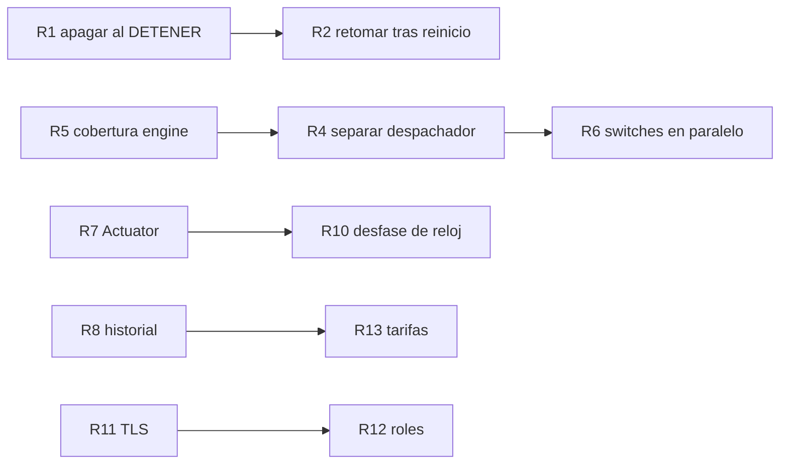

# Limitaciones conocidas y roadmap

Entregable de la iteración 6. Es para el equipo que continúe el desarrollo: qué no hace hoy el
controlador, qué riesgos asumimos a sabiendas y por dónde seguir. Las decisiones que explican cada
limitación están en el [4+1 §4.6](4mas1.md#46-qué-dice-la-letra-y-qué-decidimos) y en
[`revision-docente.md`](../planificacion/revision-docente.md) (D1–D8).

Cada limitación tiene un id (`L…`) que el roadmap usa para decir qué resuelve cada paso.

---

## 1. Limitaciones conocidas

### 1.1 Comportamiento del control

| Id | Limitación | Impacto | Qué hay hoy |
|---|---|---|---|
| L1 | **DETENER deja los switches como están.** El §5.2 no exige apagar, y decidimos no hacerlo. | Si el control se detiene con habitaciones en ON, quedan prendidas sin supervisión: no se corta la punta ni se respeta la contratada si alguien cambia algo a mano. | Documentado como decisión. El API del controlador no tiene un comando para apagar todo: hay que comandar cada switch directamente (§3). |
| L2 | **Un reinicio del contenedor arranca DETENIDO.** No se guarda si el control estaba en ejecución, ni el reloj. | Tras un corte de luz o un reinicio, nadie controla hasta que el entorno mande un INICIAR. Los switches quedan como estaban (ver L1). | El inventario sí se recupera del archivo (`RepositorioInventario`). `ApiEstandarTest.controlArrancaDetenido` fija el comportamiento. |
| L3 | **Al re-sincronizar, una lectura vigente recupera la vigencia completa** (D7). Una de 9:59 min vuelve a valer 10 min. | Con re-INICIAR seguidos, un termostato caído tarda más en detectarse. | Las lecturas ya vencidas sí se olvidan (D7). Conservar la antigüedad es la alternativa (4+1 §4.7). |
| L4 | **El modo acelerado solo se conoce por el `factorTiempo` del INICIAR.** | Un entorno que acelerara por otro canal dejaría al reloj del control con el factor viejo: tarifa y vencimientos mal calculados. | Es el único canal del contrato (§5.2), y es el que usa el simulador: en la [corrida del 2026-10-28](../tests/corrida-simulador/2026-10-28/README.md) cada escenario llegó como INICIAR con factor 60. |
| L5 | **Los relojes del simulador y del controlador se suponen sincronizados.** El `ts` se convierte con la hora real de esta máquina. | Un desfase se multiplica por el factor: 2 s a ×30 es 1 min de control. Con desfases grandes, lecturas descartadas como `TS_VENCIDO` o `FUERA_DE_ORDEN`. | En Docker sobre el mismo host comparten reloj. ±2 s a ×30 no descarta nada (`RelojControlTest`). Los descartes se ven en `/diagnostico`. |
| L6 | **El corte de la franja punta se atrasa hasta un tick** de tiempo de control (1 s). | A factores muy altos (×600 o más) el período real del tick toca el mínimo de 10 ms y el atraso crece (tabla del 4+1 §2.3). | Tick escalado con el factor (T12). Se descartó programar eventos en los bordes de la franja. |
| L7 | **Un solo sitio y una sola franja punta**, con zona fija `America/Montevideo`. | No sirve para otro país ni para tarifas con varias franjas o feriados. | La zona se puede cambiar con `CONTROL_ZONA_HORARIA`; la franja aplica a días hábiles (`HABILES`) o a todos (`TODOS`). |
| L8 | **Criterio de prioridad único**: mayor déficit primero. | No se puede priorizar por habitación (por ejemplo, el dormitorio de noche). | `CriterioPrioridad` es una interfaz: se puede agregar otro criterio sin tocar `decidir`. |

### 1.2 Comunicación y fallas

| Id | Limitación | Impacto | Qué hay hoy |
|---|---|---|---|
| L9 | **Las pasadas a los switches son secuenciales.** Un switch colgado demora a los demás hasta su timeout (2 s de conexión + 10 s de lectura: hasta 12 s). | Con varios switches colgados a la vez, los comandos a los sanos se atrasan decenas de segundos (12 s por cada uno colgado). | Al switch que falló no se le reintenta por 5 s. Se decidió no paralelizar (4+1 §3). |
| L10 | **MQTT con sesión limpia y QoS 1.** Lo publicado mientras el controlador estaba desconectado se pierde. | Tras una caída del broker, la decisión espera a la primera lectura nueva de cada habitación. | Reconexión cada 5 s con re-suscripción (`FallaBrokerMqttTest`). Si la caída supera la vigencia, la habitación se apaga por `LECTURA_VENCIDA`, que es lo seguro. |
| L11 | **Sin TLS ni usuario en MQTT; HTTP sin TLS.** La `X-API-Key` viaja en texto plano. | Solo apto para una red de confianza (la del laboratorio o la de la casa). | Una clave por dirección (controlador, entorno, switches), configurables por variables de entorno. |
| L12 | **Una sola clave de API** para todo el API del controlador, sin roles. | Quien puede consultar también puede DETENER o cambiar el sitio. | `ApiKeyFilter` exige la clave en todas las operaciones, como pide el estándar v2. |

### 1.3 Operación y código

| Id | Limitación | Impacto | Qué hay hoy |
|---|---|---|---|
| L13 | **Persistencia en un archivo JSON** (`./data/inventario.json`). Sin historial de lecturas ni de decisiones. | No hay datos para analizar consumo ni para auditar por qué se prendió algo hace una semana. | El log en INFO deja sitio aplicado, decisiones, descartes y un resumen cada 30 s (4+1 §3.2). `/diagnostico` muestra el estado actual. |
| L14 | **Sin métricas ni health check estándar** (Actuator, Prometheus). | El monitoreo es leyendo el log o consultando `/diagnostico`. | `/diagnostico` informa control, MQTT, registro, decisión y motivo por habitación y lecturas descartadas. |
| L15 | **`CoreAdapter` concentra estado, decisión y red** (unas 700 líneas). | Es la clase más difícil de cambiar; un error ahí afecta a todo el control. | Tests unitarios por estímulo y de switches, más los de integración. Separarla es la tarjeta T19. |
| L16 | **La cobertura solo se exige en el core** (JaCoCo ≥ 85 %). En el engine no se mide. | Un cambio en el engine puede quedar sin tests sin que la CI lo note. | El engine tiene tests unitarios y 8 clases de integración con broker y switches reales en el proceso. |
| L17 | **Sin tests de mutación (PIT).** | La cobertura alta del core no garantiza que los tests detecten errores. | Diferido por decisión del equipo. |

---

## 2. Roadmap

Ordenado por lo que más reduce el riesgo para el usuario. Cada paso dice qué limitación resuelve.

### Corto plazo (siguiente iteración)

| Paso | Qué | Resuelve | Notas |
|---|---|---|---|
| R1 | **Apagar al DETENER, configurable** (`control.al-detener=DEJAR\|APAGAR`, por defecto el actual) | L1 | El cambio es chico: una pasada de OFF antes de marcar detenido. Hay que acordar el default con el Product Owner. |
| R2 | **Retomar la ejecución tras un reinicio**: guardar `fechaHora`, `factorTiempo` e `iniciadoEn` junto al inventario y, al arrancar, volver a ejecución con el reloj recalculado | L2 | Depende de R1 para decidir qué hacer si el entorno no confirma. |
| R3 | **Conservar la antigüedad al re-sincronizar**: `nuevo − (ahoraViejo − instante)` en lugar de la hora nueva | L3 | Un cambio en `CoreAdapter.sincronizarReloj` y su test. |
| R4 | **Separar el despachador de switches** de `CoreAdapter` (tarjeta T19), con un mapa único de lecturas (T18) | L15 | Antes de tocar comportamiento: deja el adaptador en estado + decisión. |
| R5 | **Cobertura del engine en la CI** (JaCoCo con umbral en `adaptador` y `control`) | L16 | Medir primero y fijar el umbral sobre lo que ya hay. |

### Mediano plazo

| Paso | Qué | Resuelve | Notas |
|---|---|---|---|
| R6 | **Pasadas a switches en paralelo** (un hilo o una tarea por switch, con el mismo control de potencia) | L9 | Cuidar el orden OFF antes que ON y la retención del ON (4+1 §2.5). Más fácil después de R4. |
| R7 | **Actuator con health y métricas** (estado MQTT, registro, lecturas descartadas, comandos fallidos) | L14 | `/diagnostico` ya tiene los datos; es exponerlos en formato estándar. |
| R8 | **Historial de lecturas y decisiones** en una base de datos (PostgreSQL o SQLite) | L13 | Habilita reportes de consumo y auditoría. El inventario puede migrar a la misma base. |
| R9 | **Tests de mutación (PIT) sobre el core** | L17 | El core es Java puro y rápido: es donde PIT rinde más. |
| R10 | **Detección de desfase de reloj**: comparar el `ts` con la hora de llegada y avisar en `/diagnostico` si supera un umbral | L5 | Hoy el desfase solo se nota por descartes. |

### Largo plazo

| Paso | Qué | Resuelve | Notas |
|---|---|---|---|
| R11 | **TLS en MQTT y HTTP, y credenciales del broker** | L11 | Requiere que el estándar de interoperabilidad lo contemple; es un cambio de contrato con el simulador. |
| R12 | **Roles en el API** (lectura y operación) | L12 | También es un cambio del estándar v2. |
| R13 | **Tarifas más ricas**: varias franjas, feriados, zona por sitio | L7 | El modelo `Sitio` y `FranjaHoraria` del core es el punto de extensión. |
| R14 | **Otros criterios de prioridad** (por habitación, por horario) elegibles en el inventario | L8 | Agregar una implementación de `CriterioPrioridad` y un campo en el inventario. |
| R15 | **Varios sitios por controlador** | L7 | Cambio grande: hoy el estado del control es de un solo sitio. |

### Dependencias entre pasos

---

## 3. Preguntas abiertas

- **Default de DETENER (R1).** Lo decide el Product Owner: dejar (letra actual) o apagar (más seguro).
